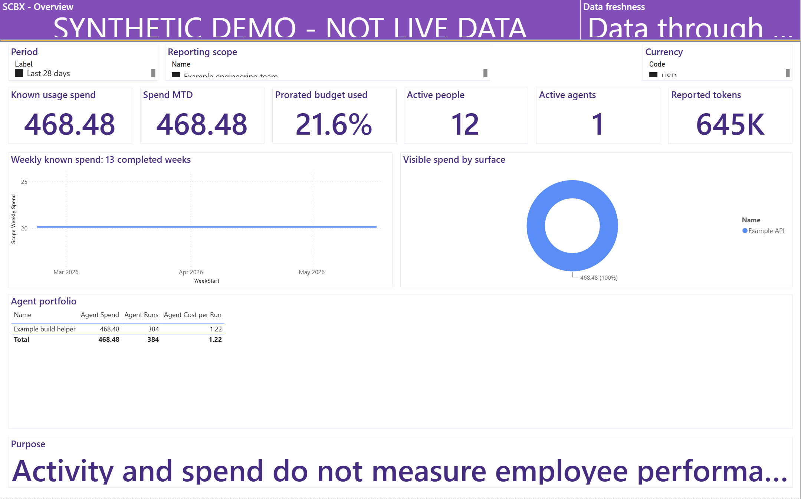

# Copilot Token Dashboard

## SCBX branch

This is the **scbx** visual variant, using the supplied **SCBX Bright** Power BI
theme and the mockups' purple/gold hierarchy. See [SCBX setup and scope](docs/SCBX.md).
The theme is registered in the editable report and embedded in its compiled PBIT.
Only synthetic data is included; the original mockup PDF is not published.

A tenant-owned Power BI installation package for AI usage, token consumption,
spend, agent operations, and data-quality reporting.

**Release status: public preview.** See the release notes for the exact validation
results and required interactive Desktop/recipient-tenant smoke tests.

**Current package: 1.0.1.** The [Thai installation guide](docs/INSTALLATION_TH.md)
includes checksum commands, PBIT/PBIP setup, source preparation and a go-live
checklist. See [recheck results](docs/VALIDATION.md) for the tested code paths.
The **SCBX branch snapshot updated 2026-11-01** includes native Desktop PBIP
repairs and genuine report screenshots. The earlier `scbx-v1.0.1` compiled PBIT
has not passed native loading; use the repaired branch PBIP for the local demo.

This is an independent open-source project. It is not an official Microsoft or
GitHub product and does not include access to Microsoft-internal telemetry.

## Sample dashboard

The image below is an **actual SCBX Power BI Desktop report-canvas capture**,
not an HTML mockup. It uses only the shipped fictional data.



See the [complete ten-page native screenshot gallery, with Thai captions](docs/SAMPLE_DASHBOARD.md),
the [original PNGs](docs/images/native/) and the
[capture settings and SHA-256 provenance](docs/images/native/provenance.json).
Power BI Desktop **2.160.407.0** rendered all ten pages without visual errors.
The captures exclude the signed-in account, ribbon and desktop. They verify a
local synthetic sample, not live source access or recipient-tenant RLS.

The [live browser companion](https://zangkasi55.github.io/Copilot-Token-Dashboard/)
and [offline HTML copy](docs/assets/sample-dashboard.html) remain separate,
neutral illustrations. They do not run Power BI, DAX or RLS.

## What you install

- A ten-page Power BI project with an editable semantic model.
- An explicitly marked synthetic demonstration dataset.
- Tenant-targeted deployment and configuration scripts.
- API collectors and a normalized CSV ingestion pipeline.
- English and Thai installation manuals and administrator documentation.

## Important boundaries

- Each organization supplies its own tenant, workspace, credentials and data.
- Power BI Desktop is free; publishing and sharing require appropriate Power BI
  or Fabric licensing and workspace permissions.
- GitHub's current APIs expose some client/model token counts, but cache details
  are not universally available. Microsoft 365 reports provide activity and
  period summaries, not general per-model token billing.
- Missing tokens, unpriced usage, attribution gaps and suppressed groups are
  not silently converted to zero.
- Organization reporting uses separate aggregate facts. Personal records remain
  self-only under the Viewer role. Workspace administrators bypass Power BI RLS
  and must be treated as trusted data custodians.
- Usage and estimated value are not employee-performance measures.

See the installation and operations documentation in `docs/`.

## Quick start

1. Download the [repaired SCBX branch source ZIP](https://github.com/zangkasi55/Copilot-Token-Dashboard/archive/refs/heads/scbx.zip)
   or clone the branch with the commands below.
2. Extract into a new folder; do not overwrite your existing installation.
3. Run `.\Install.ps1 -Action Validate -InstallDependencies`.
4. Run `.\Install.ps1 -Action Local -SourceMode Demo` to open the repaired PBIP.
5. To provision into your own tenant, follow the explicit tenant/workspace,
   credential, RLS and refresh steps in the installation guide.

```powershell
git clone --branch scbx --single-branch https://github.com/zangkasi55/Copilot-Token-Dashboard.git
Set-Location Copilot-Token-Dashboard
.\Install.ps1 -Action Validate -InstallDependencies
.\Install.ps1 -Action Local -SourceMode Demo
```

The [earlier SCBX preview release](https://github.com/zangkasi55/Copilot-Token-Dashboard/releases/tag/scbx-v1.0.1)
remains available for historical reference. Its old ZIP/PBIT does not include
the native repairs in this branch snapshot. No replacement PBIT is claimed
verified by these screenshots.

The tenant command provisions definitions; it does not silently grant source
consent, issue licenses, assign RLS groups or declare production readiness.

## Manuals

- [Installation guide](docs/INSTALLATION.md)
- [คู่มือการติดตั้งภาษาไทย](docs/INSTALLATION_TH.md)
- [Actual SCBX Power BI sample and all ten screenshots](docs/SAMPLE_DASHBOARD.md)
- [Administrator and operations manual](docs/ADMINISTRATION.md)
- [Data sources and API limits](docs/DATA_SOURCES.md)
- [Data contract](docs/DATA_CONTRACT.md)
- [User guide](docs/USER_GUIDE.md)
- [Public requirements](docs/REQUIREMENTS.md)
- [Release notes](docs/RELEASE_NOTES.md)
- [Code and installation validation results](docs/VALIDATION.md)
- [SCBX theme variant and installation notes](docs/SCBX.md)

The [English PDF](docs/manuals/Copilot%20Token%20Dashboard%20-%20Installation%20EN.pdf)
and [Thai PDF](docs/manuals/Copilot%20Token%20Dashboard%20-%20Installation%20TH.pdf)
both include all ten actual Power BI sample screenshots and captions. Rights-protected Word
outputs are not uploaded. No protected or customer-branded source documents,
actual employee records or private internal dashboard exports are distributed.

## Development checks

```powershell
python -m pip install ".[dev]"
npm ci --ignore-scripts
python -m pytest -q tests
ctd demo --output sample_data --scratch .work\demo-inputs
python tools\build_powerbi.py
python tools\validate_powerbi.py
python tools\build_sample_dashboard.py
npm run docs
npm run test:manuals
python tools\publication_check.py
```

The Power BI template compiler uses the declared optional pbi-tools **core**
build utility. That utility is not bundled. The generated PBIT is inspected for
the required package parts and complete page/model counts before release.

With the official core compiler restored to the declared tool location, run
`.\tools\Build-PowerBI.ps1`. Each build uses a new ignored scratch folder,
validates the official report schemas, serializes the semantic model, compiles
the PBIT, and checks its actual report/model contents.
