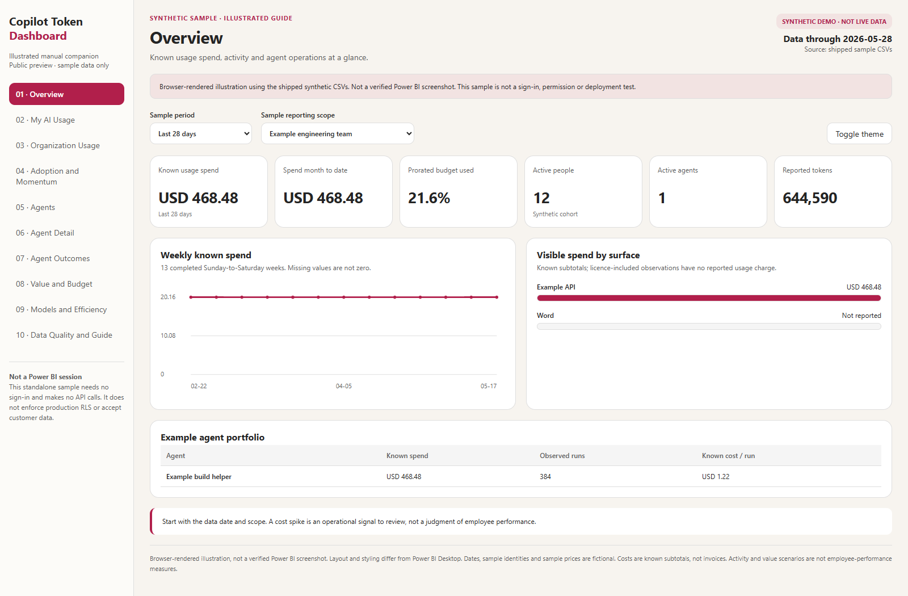
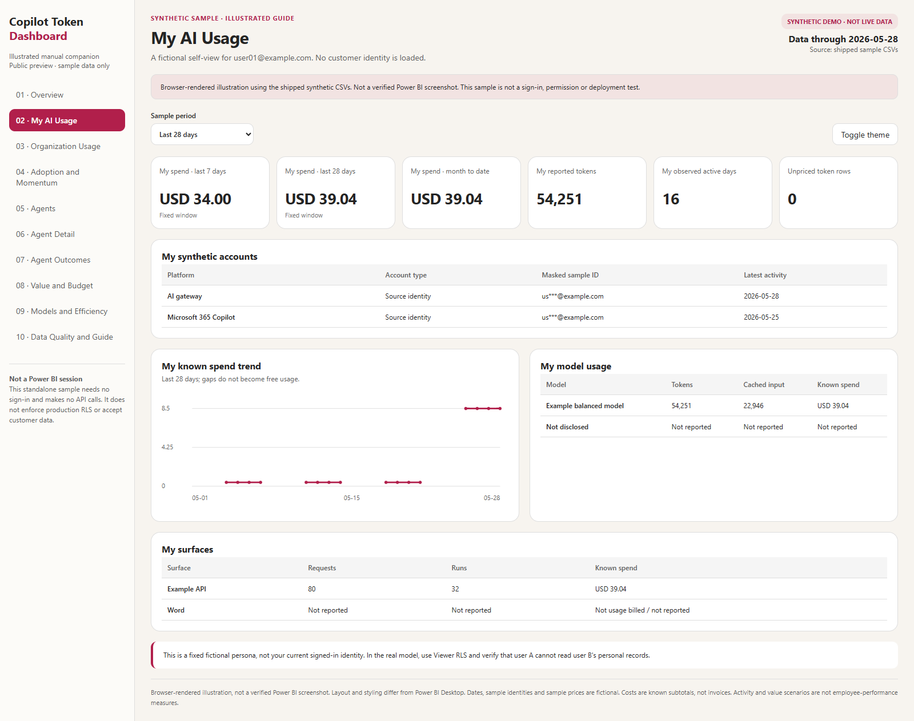
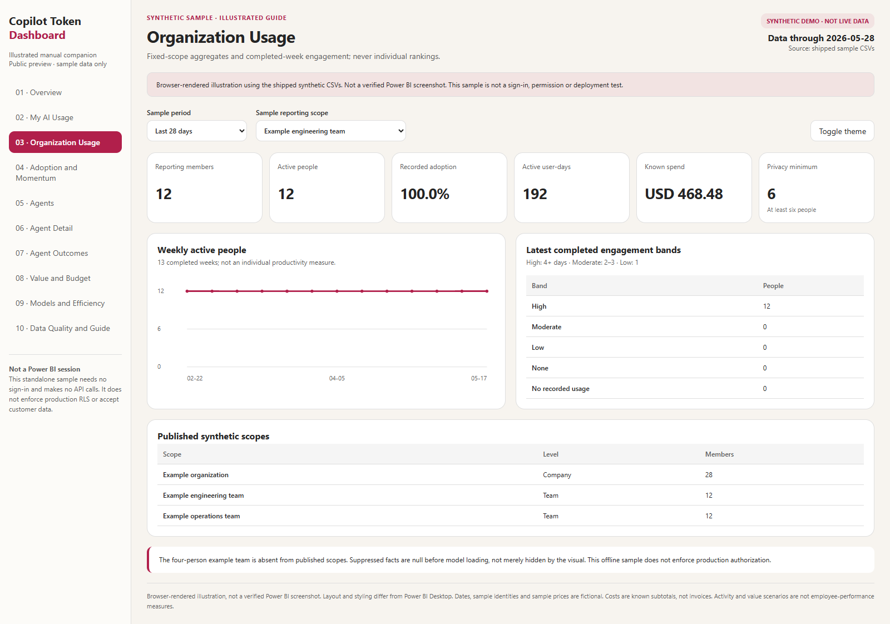
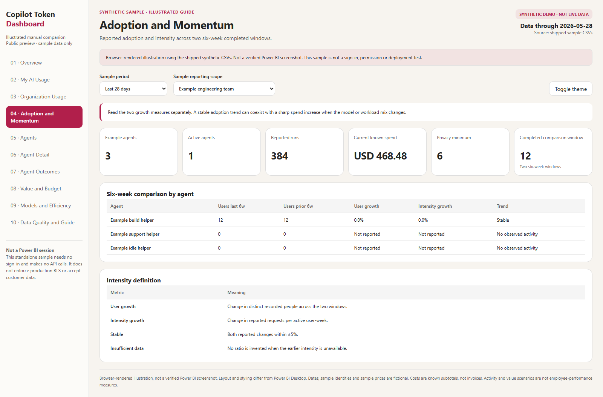
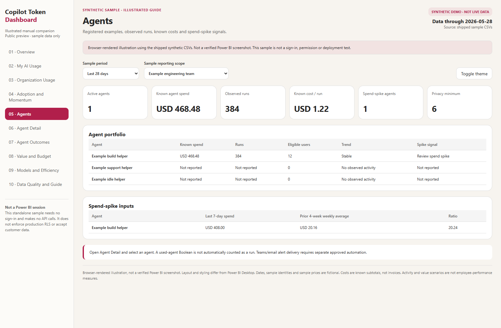
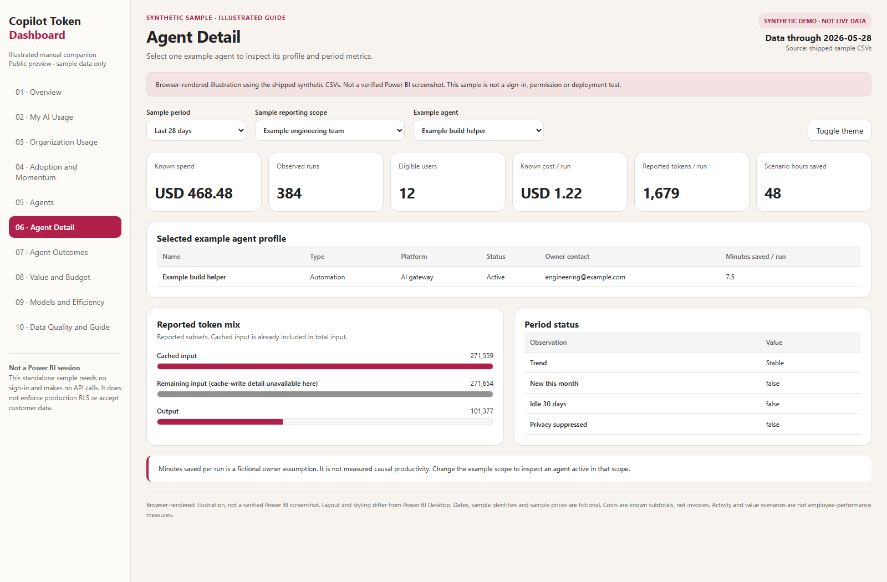
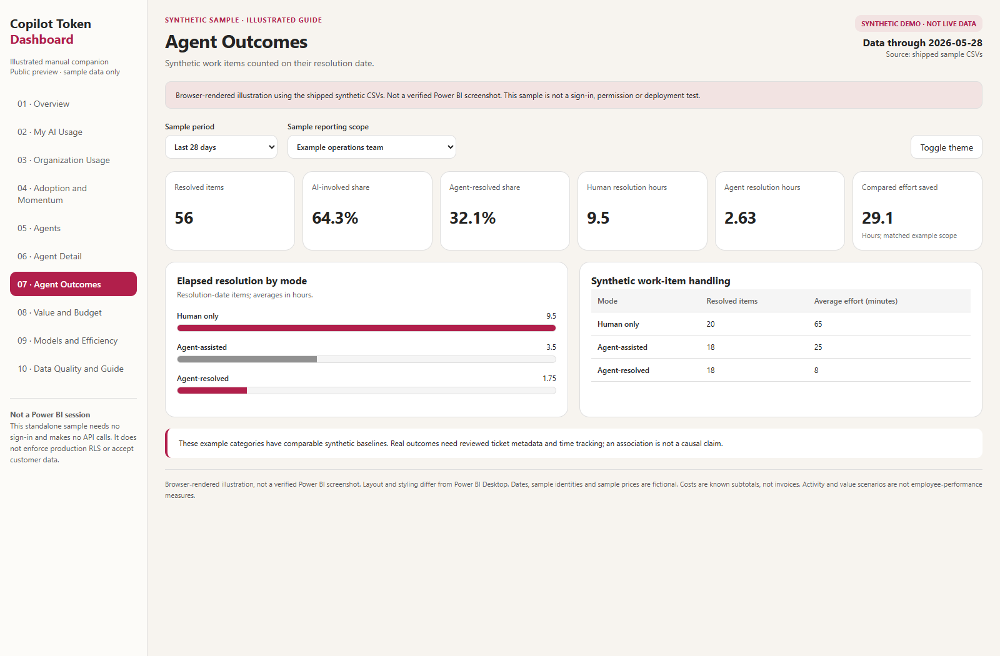
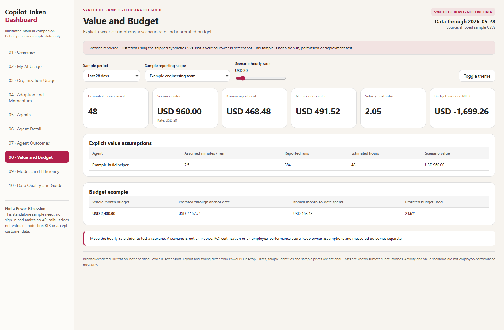
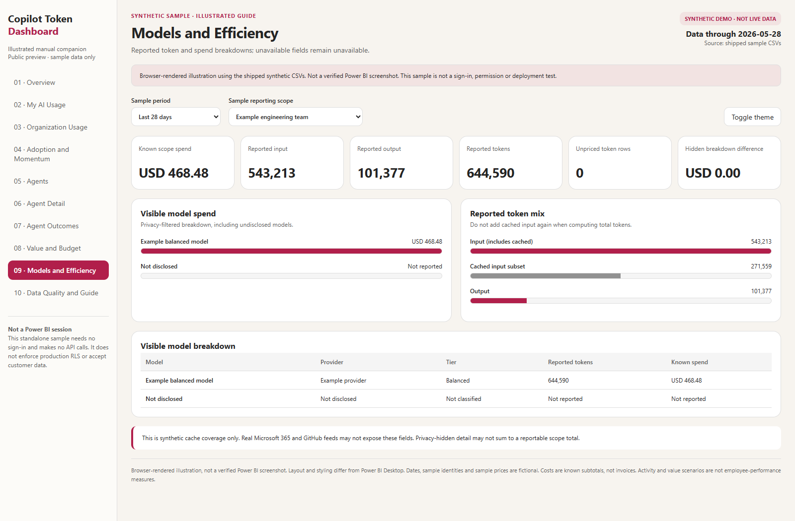
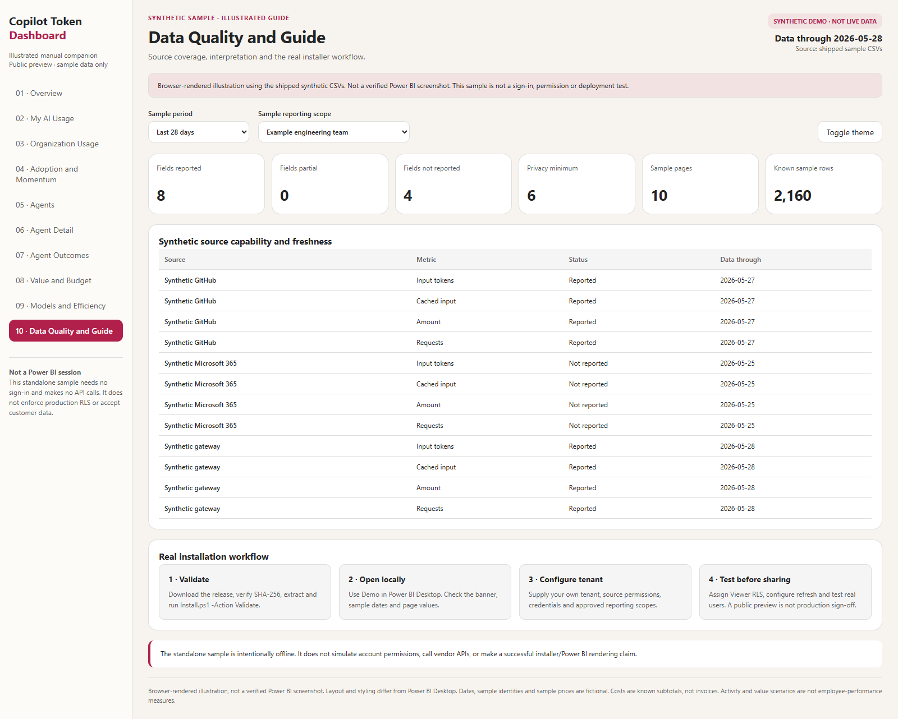

# Installation Guide

**Version 1.0.1 · rechecked 2026-11-01.**

See the [Thai illustrated installation guide](INSTALLATION_TH.md) and
[validation report](VALIDATION.md). This remains a public preview: mock tests and
schema/compiler checks are not a successful live tenant or Desktop smoke test.

## 1. What this package does

Copilot Token Dashboard is a tenant-owned Power BI reference application. It
provides ten report pages for personal usage, organization aggregates, agent
operations, models, value scenarios, budgets and data quality.

It does not grant access to another organization's data. Every recipient uses
their own Microsoft tenant, Power BI workspace, source permissions and secrets.
The installation demonstration is synthetic and is marked on every page.

**Illustrated help:** see the ten-page walkthrough in section 11 or the
[sample dashboard gallery](SAMPLE_DASHBOARD.md). You can explore the
[live synthetic sample](https://zangkasi55.github.io/Copilot-Token-Dashboard/)
or the
[offline sample dashboard](assets/sample-dashboard.html) without a tenant or
sign-in: download the HTML file and open it in Edge or Chrome.

## 2. Prerequisites

| Component | Required for |
|---|---|
| Windows and recent Power BI Desktop | Local report authoring and validation |
| Python 3.10 or later | Collectors, normalized-data build and deployment |
| PowerShell 7 | Installation script |
| Power BI Pro, PPU or suitable Fabric capacity | Publishing and sharing, as required by Microsoft licensing |
| Workspace Contributor or higher | Provisioning semantic model and report |
| Azure CLI, or a tenant-scoped Fabric token in your process environment | Automated tenant provisioning |
| Approved source permissions | Collecting actual organizational usage and billing data |

The supplied API origins target Microsoft's global commercial cloud. Sovereign
clouds and custom GitHub hosts are not validated by this release.

Power BI Desktop and optional build utilities are not redistributed.

## 3. Download and validate

Download the versioned installation ZIP from the GitHub Releases page. Verify its
SHA-256 checksum against the release checksum file, then extract it into a new
folder, for example `C:\CopilotTokenDashboard`.

```powershell
Set-Location C:\CopilotTokenDashboard
.\Install.ps1 -Action Validate -InstallDependencies
```

This restores only the declared runtime dependencies and validates the complete
synthetic table set. No tenant resources are created in Validate mode.

Expected result: the validation reports all contract tables and no errors.

Do not disable enterprise execution policies or security controls to run the
script. Follow your organization's approved script-execution process.

## 4. Open the demonstration locally

```powershell
.\Install.ps1 -Action Local -SourceMode Demo
```

The script creates a new version-specific folder under your local application
data and opens the PBIP. An existing installation folder is not overwritten.
Use `-InstallFolder C:\CTD\Demo-1.0.1` to choose a new folder.

In Power BI Desktop:

1. Wait for the project to open.
2. Select Refresh if the data is not yet loaded.
3. Confirm the synthetic-demo banner and data-through date.
4. Visit all ten report pages.
5. Use the selector on Agent Detail to review a single agent.
6. Open Modeling > View as and test the Viewer role with an example UPN.

The example people use the reserved `example.com` domain. The sample prices are
fictional; they are not vendor prices or a recommended rate card.

## 5. Publish manually into your own tenant

This path does not require an automated deployment token.

1. Sign in to Power BI Desktop with an account in the destination tenant.
2. Create or select an approved Power BI workspace.
3. Publish the opened project from Power BI Desktop.
4. Configure credentials and refresh in the Power BI Service.
5. Assign approved Entra security groups to the semantic model's Viewer role.
6. Test as real Viewer users before sharing the report or publishing an app.

A PBIT, when supplied, is opened in Desktop and instantiated there. It is not
directly imported through the Power BI Service REST API. PBIP projects are
editable source projects, not executable copies of Power BI Desktop.

## 6. Automated tenant provisioning

Use an explicitly chosen tenant and workspace:

```powershell
.\Install.ps1 -Action Tenant -SourceMode Demo `
  -TenantId '<your-tenant-guid>' `
  -WorkspaceId '<your-workspace-guid>'
```

Azure CLI authentication is performed against the specified tenant if no
`CTD_FABRIC_ACCESS_TOKEN` is present. Alternatively, acquire an approved
tenant-scoped token with `SemanticModel.ReadWrite.All` and `Report.ReadWrite.All`,
or `Item.ReadWrite.All`, and set it in the current process environment.

The script checks the token's tenant before sending any provisioning request.
The API still verifies the token's signature, audience and permissions.

The installer creates the semantic model first, then binds the report to the
created model ID. It follows Fabric long-running operations and does not
silently overwrite an existing item. Use `-Update` only after reviewing the
destination and backing up its current definitions.

The resulting state is **provisioned, configuration required**. Security-group
assignment, data-source credentials, refresh, app audiences and Viewer smoke
tests remain required. The script does not falsely declare production readiness.

## 7. Replace synthetic data with your own data

Never edit the shipped demonstration to contain real secrets or employee data
and then commit it. Work in an ignored runtime folder.

```powershell
python -m pip install .
ctd collect-github --settings config\settings.json `
  --day 2026-05-28 --output runtime\incoming\github.jsonl
ctd collect-m365 --settings config\settings.json `
  --output runtime\incoming\m365.jsonl
```

Copy `config\settings.example.json` to the ignored `config\settings.json` and
provide your tenant/app/source settings. Secrets are read from environment
variables or from an approved secret manager that populates those variables.

Prepare the input folder:

- `People.csv`, `Scopes.csv`, `ScopeAccess.csv`: required, reviewed organization
  and access mappings.
- `usage.jsonl`: normalized metadata records, combining the approved sources.
- `Models.csv`, `Surfaces.csv`, `Agents.csv`, `Budgets.csv`, `Outcomes.csv`: optional
  registry and outcome inputs using the exact public contract.
- `period-summaries.jsonl`: optional Microsoft 365 period summaries.

Use the data contract and source-capability guide. Do not spread period totals
into daily rows or infer cached tokens from input totals.

```powershell
ctd build-data --input runtime\incoming --output runtime\gold-2026-05-28
ctd validate-data --input runtime\gold-2026-05-28 --production
```

The build sets demonstration mode to false for customer data, removes
ineligible organization scopes, erases suppressed numeric facts and preserves
unpriced/unattributed records.

## 8. Customer data-source modes

### CSV

```powershell
.\Install.ps1 -Action Local -SourceMode CSV `
  -DataFolder C:\CTD\runtime\gold-2026-05-28 `
  -InstallFolder C:\CTD\Customer-1.0.1
```

The Power BI Service cannot read your local folder without a configured
on-premises data gateway. A Desktop-published snapshot can be viewed without
scheduled refresh, but it is not a live pipeline.

### SharePoint

Upload a complete, validated generation of the contract CSV files to an
approved folder in your own tenant. Use the exact folder URL, including its
trailing slash, and configure organizational OAuth credentials:

```powershell
.\Install.ps1 -Action Tenant -SourceMode SharePoint `
  -TenantId '<your-tenant-guid>' -WorkspaceId '<your-workspace-guid>' `
  -DataFolder C:\CTD\runtime\gold-2026-05-28 `
  -SharePointSite 'https://<your-tenant>.sharepoint.com/sites/AIReporting' `
  -SharePointFolder 'https://<your-tenant>.sharepoint.com/sites/AIReporting/Shared Documents/Gold/'
```

The local validated folder is required as a preflight mirror. The model reads
the SharePoint files after deployment, not that local mirror.

A file must match its expected name and exact folder once; missing or duplicate
matches fail explicitly. Credentials are not shipped in the model.

Version 1.0.1 validates that the HTTPS folder is genuinely under the selected
site and has its trailing slash before copying/deployment. Local CSV paths are
resolved to absolute paths. Data validation also rejects malformed Settings,
incorrect row widths, unknown fact references and small unsuppressed cohorts.

## 9. Security and go-live checks

- Use the Viewer RLS role; app page visibility is not a security boundary.
- Give consumers Viewer/app access, not Workspace Member or Contributor.
- Do not grant broad Build/export permissions without a data-protection review.
- Assign your own sensitivity label in the destination tenant.
- Verify personal user A cannot see user B's personal rows.
- Verify a small scope is absent and suppressed aggregate rows contain no
  numeric facts, even through dataset access.
- Configure refresh only after a complete data generation is uploaded.
- Test all source credentials and permissions in the destination tenant.
- Confirm no demo identities remain in customer data.
- Review access and source coverage periodically.

This is not a legal-compliance certification or an employee-performance tool.

## 10. Troubleshooting

| Symptom | Action |
|---|---|
| Python dependency error | Install the declared runtime package; do not install arbitrary packages |
| CSV header/type error | Compare exact column order/types with the contract |
| Missing tokens or cached tokens | Inspect source coverage; do not substitute zero |
| Unexpected spend totals | Compare billed/estimated basis, unattributed rows and privacy-hidden breakdowns |
| No personal rows | Confirm the actual UPN mapping and Viewer role membership |
| Blank organization scope | Confirm approved scope access and the six-person minimum |
| HTTP 403 | Obtain required consent/role/policy; do not bypass the restriction |
| Existing item conflict | Inspect the destination; use Update only deliberately |
| Refresh failure | Configure credentials, gateway and source-folder permissions |
| Long-running operation timeout | Inspect the workspace and operation before retrying creation |

The accompanying administrator and source-capability manuals provide detailed
operating boundaries.

## 11. Illustrated sample dashboard walkthrough

The following screenshots were captured from the standalone browser sample using
the shipped synthetic CSV data. **They are illustrations, not verified Power BI
Desktop screenshots.** The companion uses a simplified layout and different
styling; it does not run DAX, call APIs, test authentication or enforce RLS.
Production acceptance still requires the actual Power BI project in your tenant.

For figures 1–6 and 8–10, select **Last 28 days** and **Example engineering team**.
Figure 7 uses **Example operations team**. The personal page uses the fixed
fictional viewer **user01@example.com**. All examples end on **2026-05-28**.
Click an image on GitHub to view its original 1600-pixel-wide PNG; the PDF
embeds the image so it is available offline and can be zoomed.

### Figure 1. Overview: check the scope and data date



1. Check the SYNTHETIC DEMO banner and data-through date before reading a value.
2. For the engineering example, known 28-day spend is **USD 468.48**, with
   **12 active people**, **1 active agent** and **644,590 reported tokens**.
3. The weekly chart covers completed weeks. The current spend spike is not
   retroactively added to earlier completed weeks. Word's missing usage price
   remains unavailable instead of being treated as a metered zero.

### Figure 2. My AI Usage: validate the fictional self-view



The example user's spend is **USD 34.00 for seven days**, **USD 39.04 for
28 days** and **USD 39.04 month to date**. The tables show masked accounts,
reported model tokens and unavailable fields explicitly.

In the real Power BI model, test the Viewer role with two actual UPNs. Never use
this fixed browser persona as evidence that tenant RLS works.

### Figure 3. Organization Usage: understand privacy and completed weeks



The engineering scope contains **12 members**. A four-person example team is
absent from the published scope list because the minimum is six. High engagement
means four or more observed days in a completed week; it is not a productivity
rating. The HTML has no authorization boundary; production protection comes from
the reviewed aggregate pipeline and the Power BI Viewer role.

### Figure 4. Adoption and Momentum: interpret the two growth axes



Compare the latest six completed weeks with the preceding six. User growth and
requests per active user-week are different measures. The example build helper
is **Stable** in these windows even though its latest spend spikes, because the
spike falls outside the last completed comparison window.

### Figure 5. Agents: investigate a spend flag



The example build helper has **384 reported runs** in the selected period.
Its last-seven-day spend is **USD 408.00**, compared with a prior four-week
weekly average of **USD 20.16**. Review the workload and source coverage instead
of interpreting the flag as an employee-performance judgment. Notifications
require separate approved automation.

### Figure 6. Agent Detail: select one registered example



Open Agent Detail and use the agent selector. The build helper's known cost per
run is approximately **USD 1.22**. Its seven-and-a-half-minute saved-per-run
setting is a fictional owner assumption, not a measured benefit.

If an agent has no activity in the current scope, change to its approved scope.
Do not replace absent metrics with invented values.

### Figure 7. Agent Outcomes: use the operations example



Select **Example operations team**. The sample has **56 resolved items**:
20 human-only, 18 agent-assisted and 18 agent-resolved. Elapsed hours and tracked
human effort are separate quantities. The example comparison does not establish
causation or replace review of your own ITSM data.

### Figure 8. Value and Budget: test assumptions, not guarantees



At **USD 20 per hour**, the build-helper example shows **48 estimated hours**
and **USD 960.00 scenario value**. Changing the sample slider to USD 40 doubles
the value to USD 1,920.00; it does not change measured spend or prove productivity.
Budget is prorated through the displayed anchor date.

### Figure 9. Models and Efficiency: reconcile known subtotals



Input includes the cached-input subset: **do not add cached tokens a second time**.
Compare known model/surface subtotals with the scope total and inspect any
privacy-hidden difference. The sample's fictional cache coverage is not a promise
that Microsoft 365 or GitHub APIs expose the same fields in production.

### Figure 10. Data Quality and Guide: finish the installation checklist



The example coverage table has **8 reported**, **0 partial** and **4 unavailable**
source-field entries. These are sample capabilities, not a live connection test.
Complete Validate, local Desktop checks, tenant/source configuration, Viewer
security tests and refresh verification before sharing.

The [sample dashboard gallery](SAMPLE_DASHBOARD.md) also explains how to explore
the offline HTML and open every original screenshot.
