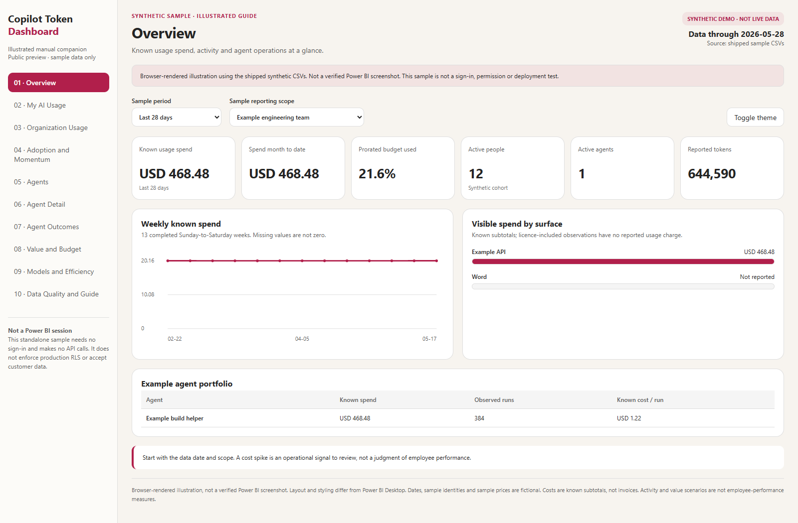
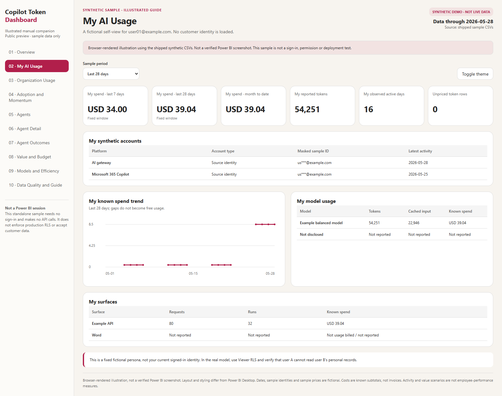
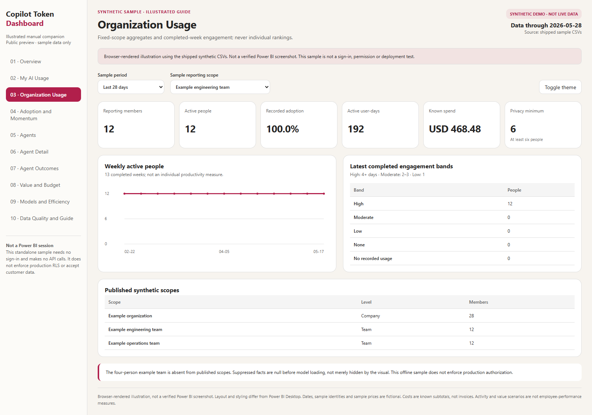
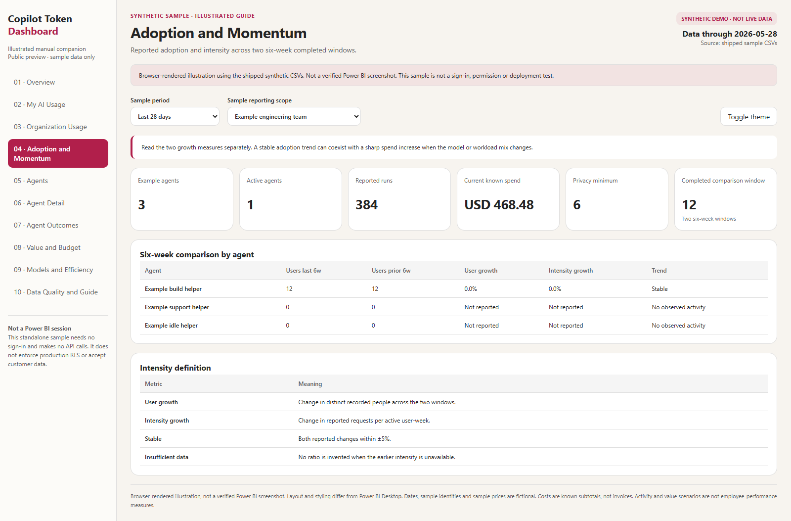
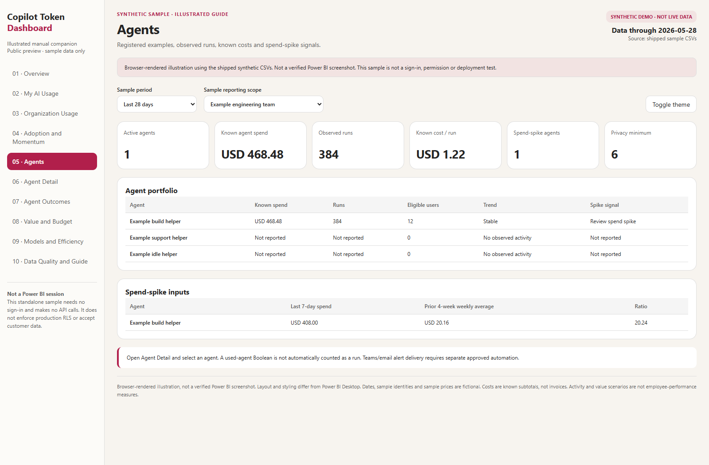
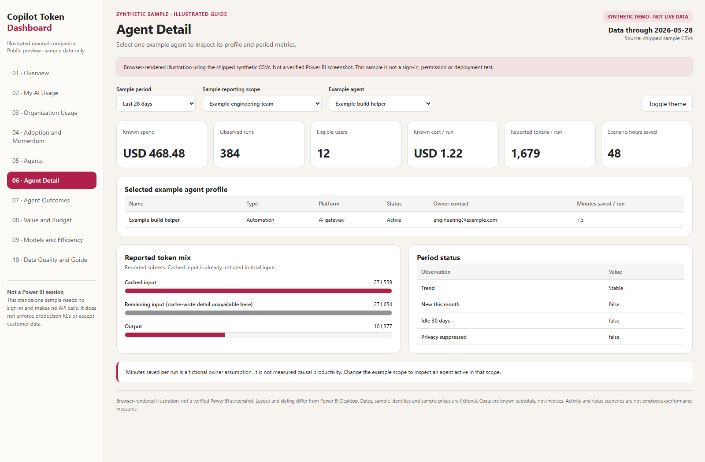
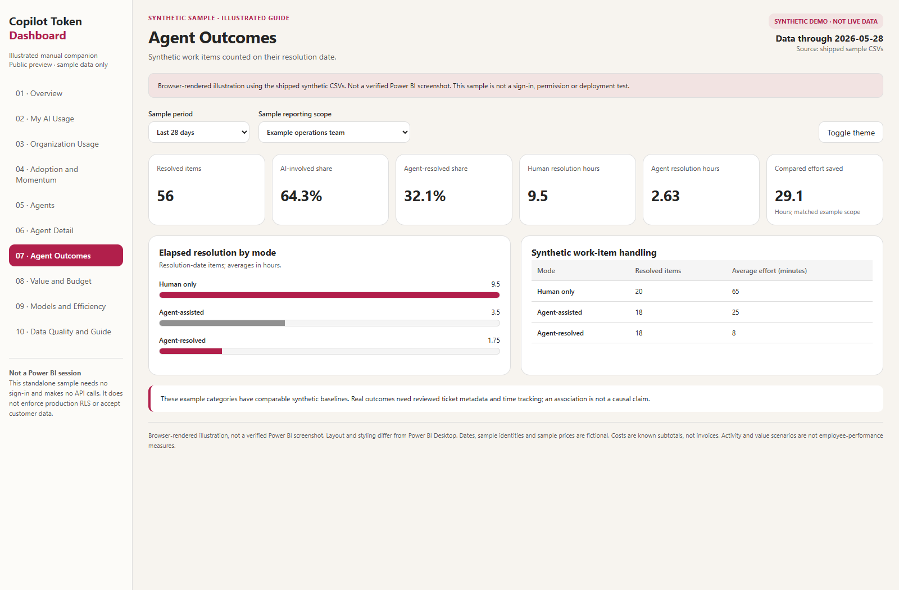
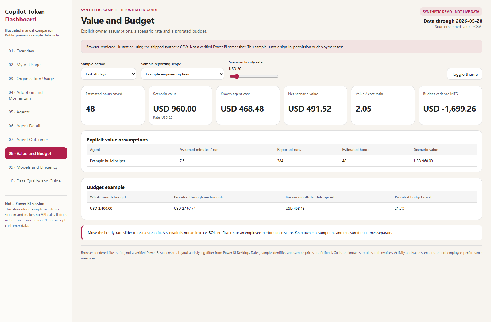
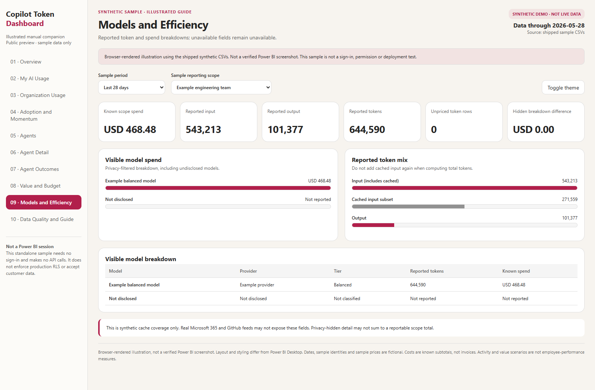
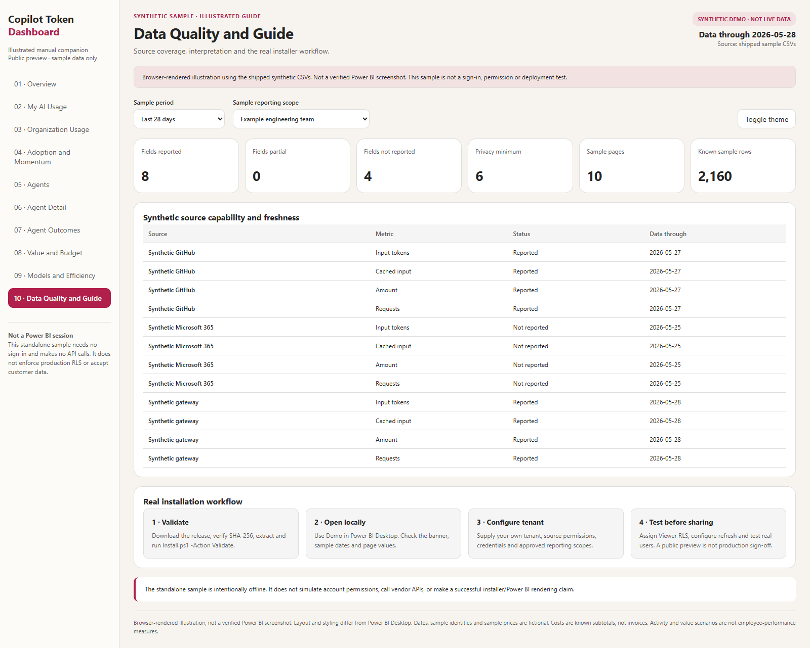

# คู่มือการติดตั้ง Copilot Token Dashboard

**รุ่น 1.0.1 · ปรับปรุงและทดสอบซ้ำวันที่ 1 พฤศจิกายน 2569 (2026-11-01)**

คู่มือนี้ใช้กับ [ชุดติดตั้ง v1.0.1](https://github.com/zangkasi55/Copilot-Token-Dashboard/releases/tag/v1.0.1)
และ [PDF ภาษาไทย](https://github.com/zangkasi55/Copilot-Token-Dashboard/releases/download/v1.0.1/Copilot-Token-Dashboard-Installation-TH.pdf)
ผลการตรวจโค้ดและขอบเขตที่ยังต้องทดสอบใน tenant อยู่ใน [รายงานการทดสอบ](VALIDATION.md)

**สถานะยังเป็น public preview** การผ่าน unit tests, schema และการสร้าง PBIT
ไม่ได้ยืนยันว่ารายงาน render หรือเชื่อมต่อ source จริงใน tenant ของคุณแล้ว
ต้องผ่าน checklist ก่อน go-live ในหัวข้อ 9 ก่อนใช้งาน production

## 1. ภาพรวม

ชุดนี้เป็นรายงาน Power BI แบบโอเพนซอร์สสำหรับติดตั้งใน tenant ขององค์กรคุณเอง
มี 10 หน้า ครอบคลุมการใช้งานส่วนตัว ข้อมูลรวมขององค์กร agent โมเดล
งบประมาณ สมมติฐานด้านคุณค่า และคุณภาพข้อมูล

ชุดนี้ไม่ได้ให้สิทธิ์อ่านข้อมูลขององค์กรอื่น และไม่ได้เชื่อมต่อข้อมูลภายในของ Microsoft
ผู้ติดตั้งต้องใช้ tenant, workspace, สิทธิ์, ข้อมูล และ secret ของตนเอง
ข้อมูลที่ให้มาสาธิตเป็นข้อมูลสมมติและมีป้ายกำกับทุกหน้า

ดูภาพประกอบครบทั้ง 10 หน้าในหัวข้อ 11 หรือ
[แกลเลอรีแดชบอร์ดตัวอย่าง](SAMPLE_DASHBOARD.md)
เปิด [ตัวอย่างข้อมูลสมมติบนเว็บ](https://zangkasi55.github.io/Copilot-Token-Dashboard/)
หรือ
ดาวน์โหลด [แดชบอร์ด HTML แบบออฟไลน์](assets/sample-dashboard.html)
แล้วเปิดใน Edge หรือ Chrome ได้โดยไม่ต้องมี tenant หรือเข้าสู่ระบบ

## 2. สิ่งที่ต้องเตรียม

| รายการ | ใช้สำหรับ |
|---|---|
| Windows และ Power BI Desktop รุ่นปัจจุบัน | เปิดและตรวจรายงานบนเครื่อง |
| Python 3.10 ขึ้นไป | ตัวเก็บข้อมูล การสร้างข้อมูลรายงาน และ deployment |
| PowerShell 7 | สคริปต์ติดตั้ง |
| Power BI Pro, PPU หรือ Fabric capacity ที่เหมาะสม | เผยแพร่และแชร์ตามเงื่อนไข license |
| สิทธิ์ Contributor ขึ้นไปใน workspace | สร้าง semantic model และรายงาน |
| Azure CLI หรือ Fabric access token ของ tenant เป้าหมาย | deployment แบบอัตโนมัติ |
| การอนุมัติสิทธิ์จากเจ้าของข้อมูล | เก็บข้อมูลจริงผ่าน API |

API ในรุ่นนี้ใช้ global commercial cloud ยังไม่ได้ยืนยัน sovereign cloud
หรือ GitHub host ที่กำหนดเอง ชุดนี้ไม่ได้แจกโปรแกรม Power BI Desktop

### 2.1 เลือกเส้นทางติดตั้ง

| สิ่งที่ต้องการ | เส้นทางที่ใช้ | สิ่งที่ต้องเตรียมเพิ่มเติม |
|---|---|---|
| ดูข้อมูลสมมติบนเครื่อง | เปิด PBIT ใน Desktop ตามหัวข้อ 4.1 | ไม่ต้องมี Python หรือ tenant สำหรับดูตัวอย่างใน Desktop |
| ติดตั้ง PBIP พร้อมตรวจข้อมูล | Install.ps1 -Action Local | Python และ dependency ที่ประกาศไว้ |
| Publish ด้วยบัญชีของคุณ | Publish จาก Desktop ตามหัวข้อ 5 | บัญชี tenant ปลายทางและ license ที่เหมาะสม |
| สร้าง model และ report ผ่าน API | Install.ps1 -Action Tenant | TenantId, WorkspaceId, Fabric token และสิทธิ์ที่ถูกต้อง |

ตรวจเครื่องมือใน terminal ก่อนเริ่ม:

```powershell
$PSVersionTable.PSVersion
Get-Command python
python --version
```

ใช้ PowerShell 7 ขึ้นไปสำหรับสคริปต์นี้ และ Python 3.10 ขึ้นไป
ตรวจว่า python เป็น interpreter ที่คุณตั้งใจใช้ หากองค์กรกำหนด virtual environment
ให้เปิด environment นั้นก่อนรัน Install.ps1 เพื่อให้ dependency อยู่ในที่เดียวกัน
การดูตัวอย่างในเว็บไม่ใช่การตรวจว่า Power BI Desktop ใช้งานได้

## 3. ดาวน์โหลดและตรวจชุด

ดาวน์โหลดไฟล์ ZIP และ SHA256SUMS จาก release เดียวกัน:

- Copilot-Token-Dashboard-1.0.1-Install.zip
- Copilot-Token-Dashboard-1.0.1-SHA256SUMS.txt

อย่าใช้ checksum ของรุ่น 1.0.0 ตรวจ ZIP รุ่น 1.0.1
ตรวจ SHA-256 แล้วแตกไฟล์ลงโฟลเดอร์ใหม่ เช่น
`C:\CopilotTokenDashboard`

### 3.1 ตรวจ checksum ก่อนแตก ZIP

ตัวอย่างต่อไปนี้สมมติว่าทั้งสองไฟล์อยู่ในโฟลเดอร์ Downloads
ปรับตำแหน่งให้ตรงกับไฟล์ที่คุณดาวน์โหลด:

```powershell
$zip = Join-Path $env:USERPROFILE 'Downloads\Copilot-Token-Dashboard-1.0.1-Install.zip'
$sums = Join-Path $env:USERPROFILE 'Downloads\Copilot-Token-Dashboard-1.0.1-SHA256SUMS.txt'
$name = [IO.Path]::GetFileName($zip)
$entry = @(Get-Content -LiteralPath $sums | Where-Object { $_.EndsWith('  ' + $name) })
if ($entry.Count -ne 1) { throw 'Expected exactly one checksum entry.' }
$expected = ($entry[0] -split '\s+', 2)[0]
$actual = (Get-FileHash -LiteralPath $zip -Algorithm SHA256).Hash
if ($actual -ne $expected) { throw 'Checksum mismatch. Do not install this file.' }
'SHA256 PASS'
Expand-Archive -LiteralPath $zip -DestinationPath 'C:\CopilotTokenDashboard-1.0.1'
```

ผลที่ควรเห็นคือ SHA256 PASS หากไม่ตรงให้หยุดและดาวน์โหลดใหม่จาก release ที่ถูกต้อง
อย่าใช้ Force เพื่อเขียนทับโฟลเดอร์ติดตั้งเดิมที่มีข้อมูลหรือ config ของคุณ

### 3.2 ตรวจข้อมูลและ dependency โดยยังไม่สร้าง resource

```powershell
Set-Location C:\CopilotTokenDashboard-1.0.1
.\Install.ps1 -Action Validate -InstallDependencies
```

คำสั่งนี้ติดตั้งเฉพาะ dependency ที่ประกาศไว้ และตรวจข้อมูลสมมติทุกตาราง
ยังไม่สร้าง resource ใน tenant

ผลที่ควรเห็น:

- validated เป็น true และ tables เท่ากับ 21 ซึ่งเป็นตาราง CSV ตาม data contract
- source_validated เป็น true และ model_updated เป็น false
- ข้อความ Data and dependency checks passed. No tenant resources were created.

semantic model มี 22 ตาราง เพราะรวมตาราง Measures อีกหนึ่งตาราง
อย่าสับสนจำนวนตาราง CSV 21 ตารางกับจำนวนตารางในโมเดล 22 ตาราง

อย่าปิด execution policy หรือมาตรการรักษาความปลอดภัยขององค์กร
ให้ใช้กระบวนการรันสคริปต์ที่องค์กรอนุมัติ

## 4. เปิดข้อมูลสาธิตบนเครื่อง

### 4.1 เปิด PBIT โดยไม่ใช้สคริปต์

1. เปิด Copilot-Token-Dashboard-1.0.1.pbit จากโฟลเดอร์ชุดติดตั้งด้วย Power BI Desktop
2. เมื่อถามพารามิเตอร์ ให้ตั้ง SourceMode เป็น Demo
3. DataFolder, SharePointSite และ SharePointFolder เว้นว่างได้ใน Demo
4. รอให้โหลดข้อมูลหรือกด Refresh แล้วตรวจป้าย SYNTHETIC DEMO
5. Save As เป็น PBIX ในโฟลเดอร์ทำงานของคุณ ก่อน Publish ถ้าต้องการ

PBIT รวมนิยามรายงานและโมเดล ไม่ได้ให้ credentials ของ source
ในโหมด CSV หรือ SharePoint ต้องตั้งค่าตามหัวข้อ 8
หาก Desktop ค้างหรือ render ไม่ได้ อย่าถือว่าภาพสาธิตในเว็บเป็นผลทดสอบแทน

### 4.2 ติดตั้ง PBIP ด้วยสคริปต์

```powershell
.\Install.ps1 -Action Local -SourceMode Demo
```

สคริปต์สร้างโฟลเดอร์ CopilotTokenDashboard\1.0.1 ใน local application data แล้วเปิด PBIP
ไม่เขียนทับโฟลเดอร์ติดตั้งเดิม หากมีโฟลเดอร์แล้วให้กำหนด `-InstallFolder`
เป็นโฟลเดอร์ใหม่

ใน Power BI Desktop:

1. รอให้โปรเจกต์เปิดเสร็จ แล้วกด Refresh ถ้ายังไม่มีข้อมูล
2. ตรวจป้ายข้อมูลสมมติและวันที่ Data through
3. เปิดตรวจรายงานครบทั้ง 10 หน้า
4. เลือก agent ด้วยตัวเลือกในหน้า Agent Detail
5. ใช้ Modeling > View as ทดสอบ role Viewer กับ UPN ตัวอย่าง

บุคคลตัวอย่างใช้โดเมน `example.com` และราคาตัวอย่างเป็นราคาสมมติ
ไม่ใช่ราคาผู้ให้บริการหรือ rate card ที่แนะนำ

### 4.3 ตรวจค่าตัวอย่างก่อน Publish

เลือก Last 28 days และ Example engineering team เพื่อเทียบค่าต่อไปนี้
ใน Desktop ที่ไม่มีสิทธิ์ scope ของข้อมูลตัวอย่าง อาจต้องเลือก scope เอง
หน้าส่วนตัวใน Demo ใช้ user01@example.com เมื่อบัญชีปัจจุบันไม่มีอยู่ในข้อมูล:

| รายการ | ค่าที่ควรเทียบ |
|---|---|
| วันที่ข้อมูล | 2026-05-28 |
| Known scope spend ใน 28 วัน | USD 468.48 |
| Active people ของ engineering | 12 |
| Reported tokens ของ engineering | 644,590 |
| My spend เจ็ดวัน | USD 34.00 |
| My spend 28 วันและตั้งแต่ต้นเดือน | USD 39.04 |

ตารางนี้เป็นค่าจากข้อมูลสมมติ ไม่ใช่ยอดของ tenant หรือบัญชีจริง
ตรวจ actual Desktop และ View as แยกจากภาพ browser ในหัวข้อ 11

## 5. Publish แบบทำด้วยตนเอง

วิธีนี้ไม่ต้องใช้ token สำหรับ deployment อัตโนมัติ:

1. ลงชื่อเข้าใช้ Power BI Desktop ด้วยบัญชีของ tenant ปลายทาง
2. สร้างหรือเลือก workspace ที่องค์กรอนุมัติ
3. Publish จาก Power BI Desktop
4. ตั้ง credentials และ Refresh ใน Power BI Service
5. เพิ่มกลุ่ม Entra ที่อนุมัติให้เป็นสมาชิก role Viewer ของ semantic model
6. ทดสอบด้วยผู้ใช้ Viewer จริงก่อนแชร์หรือสร้าง Power BI App

PBIT ต้องเปิดใน Desktop ก่อน แล้วสร้างรายงานจาก template
ไม่ใช่ไฟล์ที่ import ตรงเข้า Power BI Service REST API
PBIP เป็น source project สำหรับแก้ไขรายงานและโมเดล ไม่ใช่โปรแกรม Power BI

## 6. สร้างรายงานใน tenant แบบอัตโนมัติ

ต้องระบุ tenant และ workspace อย่างชัดเจน:

```powershell
.\Install.ps1 -Action Tenant -SourceMode Demo `
  -TenantId '<your-tenant-guid>' `
  -WorkspaceId '<your-workspace-guid>'
```

หากไม่มี `CTD_FABRIC_ACCESS_TOKEN` สคริปต์จะลงชื่อเข้าใช้ Azure CLI
ใน tenant ที่ระบุ หรือคุณอาจตั้ง token ที่องค์กรอนุมัติใน environment ของ process
สิทธิ์ที่ API ต้องการคือ SemanticModel.ReadWrite.All และ Report.ReadWrite.All
หรือ Item.ReadWrite.All

สคริปต์ตรวจว่า token เป็นของ tenant เป้าหมายก่อนส่งคำขอ
API ของ Microsoft ยังเป็นผู้ตรวจ signature, audience และสิทธิ์จริง

ระบบสร้าง semantic model ก่อน แล้วผูกรายงานด้วย model ID ที่สร้าง
รอผล long-running operation และไม่เขียนทับ item เดิมโดยเงียบ
ใช้ `-Update` หลังตรวจปลายทางและสำรอง definition แล้วเท่านั้น

สถานะที่ได้คือ **สร้าง resource แล้ว แต่ยังต้องตั้งค่าความปลอดภัยและ refresh**
ยังต้องกำหนดกลุ่ม RLS, credentials, gateway ถ้าจำเป็น, app audiences
และทดสอบ Viewer ก่อนถือว่าพร้อมใช้งานจริง

บันทึกผล deployment อยู่ใน runtime\deployment.json ของโฟลเดอร์ชุดติดตั้ง
อ่าน report_url และ next_steps จากไฟล์นั้น โดยไม่ส่ง tenant IDs หรือไฟล์ config
ที่ยังไม่ตรวจให้ public GitHub issue
หากพบ item เดิม ให้ตรวจ workspace และสำรอง definition ก่อนใช้ -Update
หากมี error หลังสร้าง semantic model แล้ว ให้ตรวจ resource ที่สร้างก่อนรันซ้ำ
สคริปต์ไม่ได้ลบ resource ที่สร้างไปแล้วอัตโนมัติ

## 7. ใช้ข้อมูลของคุณเอง

อย่าใส่ข้อมูลจริงหรือ secret ลงในข้อมูลสาธิตแล้ว commit ขึ้น GitHub
ให้ทำงานในโฟลเดอร์ runtime ที่ถูกตัดออกจาก source control

```powershell
python -m pip install .
ctd collect-github --settings config\settings.json `
  --day 2026-05-28 --output runtime\incoming\github.jsonl
ctd collect-m365 --settings config\settings.json `
  --output runtime\incoming\m365.jsonl
```

คัดลอก settings.example.json เป็น settings.json ซึ่งถูก ignore ไว้
ใส่เฉพาะ tenant, app และรายละเอียด source ส่วนค่าจริงของ secret
อยู่ใน environment หรือ secret manager ที่องค์กรอนุมัติ

### 7.1 ตั้ง config และสิทธิ์ source

```powershell
Copy-Item -LiteralPath config\settings.example.json -Destination config\settings.json
```

| ค่า | สิ่งที่ต้องใส่ |
|---|---|
| tenant_id | GUID ของ Microsoft tenant ของคุณ |
| graph_client_id | App registration ของ tenant นั้น |
| github.scope_type | enterprise หรือ organization ตามขอบเขตที่ได้รับสิทธิ์ |
| github.scope_name | ชื่อ enterprise หรือ organization จริง ไม่ใช่ชื่อ repository |
| github.root_scope_key | คีย์ scope ที่มีอยู่ใน Scopes.csv |
| github.login_map_file | ที่อยู่ CSV ซึ่งมีคอลัมน์ login และ upn |
| m365.period | D7, D28, D90 หรือ D180 |

เก็บ token/secret จริงใน process environment เช่น CTD_GITHUB_TOKEN
และ CTD_GRAPH_CLIENT_SECRET หรือให้ secret manager ที่องค์กรอนุมัติส่งค่าเหล่านี้
อย่าเขียนค่าจริงลง settings.json, PBIP, PBIT หรือ commit
อย่าวาง token ในคำสั่งที่ถูกบันทึกเป็น terminal history โดยไม่ป้องกัน

Microsoft 365 collector ต้องมี Reports.Read.All พร้อม admin consent
directory collector ต้องมี User.Read.All
GitHub ต้องมีสิทธิ์อ่าน Copilot metrics และเปิด policy ตามเอกสาร source
--include-billing ใช้สำหรับ enterprise scope และต้องมีสิทธิ์อ่าน billing เพิ่ม
HTTP 403 ต้องแก้ด้วย consent/role/policy ไม่ใช่เปลี่ยนให้โค้ดข้ามการตรวจ

### 7.2 เตรียมข้อมูลและรวม JSONL ให้ตรงสัญญา

เตรียม People.csv, Scopes.csv และ ScopeAccess.csv ตาม data contract
รวม metadata ที่ผ่านการตรวจเป็น usage.jsonl
อาจเพิ่ม Models, Surfaces, Agents, Budgets และ Outcomes
รวมทั้ง period-summaries.jsonl จากรายงาน Microsoft 365

ตาราง directory ที่ collect-directory ส่งออกยังไม่ใช่ People.csv พร้อมใช้
ต้องตรวจการจับคู่ HR, PersonKey, UPN, scope และสิทธิ์ก่อน
ห้ามนำบุคคลตัวอย่างมาเปลี่ยนเพียง IsDemo=False เพื่อหลบการตรวจ production

ถ้าเปิดทั้ง GitHub และ Microsoft 365 แล้ว ตัวอย่างการรวมไฟล์เป็นดังนี้:

```powershell
$sources = @('runtime\incoming\github.jsonl', 'runtime\incoming\m365.jsonl')
Get-Content -LiteralPath $sources |
  Set-Content -LiteralPath runtime\incoming\usage.jsonl -Encoding utf8
Copy-Item -LiteralPath runtime\incoming\m365.period-summary.jsonl `
  -Destination runtime\incoming\period-summaries.jsonl
```

รวมเฉพาะ source ที่คุณโหลดสำเร็จจริง และอย่ารวม directory export
หรือ period-summary เข้า usage.jsonl เพราะข้อมูลมีรูปแบบคนละแบบ

ห้ามกระจายยอดรวมของช่วงเวลาให้เป็นยอดรายวัน
และห้ามเดา cached tokens จากยอด input tokens

```powershell
ctd build-data --input runtime\incoming --output runtime\gold-2026-05-28
ctd validate-data --input runtime\gold-2026-05-28 --production
```

ข้อมูลจริงถูกสร้างโดยปิด demo mode
scope ที่ไม่ถึงเกณฑ์ถูกตัดออก และตัวเลขของแถวที่ถูก suppress ถูกล้างก่อนเข้าโมเดล
รายการที่ยังไม่มีราคาและรายการที่ยังระบุเจ้าของไม่ได้ยังคงถูกแจ้งอย่างชัดเจน

รุ่น 1.0.1 ตรวจ Settings ให้มีหนึ่งแถวและ IsDemo เป็น Boolean ที่ระบุชัดเจน
ตรวจจำนวนคอลัมน์ CSV และคีย์ fact ที่อ้างถึงตารางอื่น
แถว aggregate ที่มี active cohort ต่ำกว่าเกณฑ์แต่ไม่ได้ suppress จะถูกปฏิเสธ
แก้ข้อมูลต้นทางตาม error แทนการลดเกณฑ์ความเป็นส่วนตัว

ค่าใช้จ่ายใช้ USD เป็นค่าเริ่มต้น ไม่มีการแปลง FX อัตโนมัติจาก settings.fx_rates
หากต้องใช้ THB ต้องมีขั้นตอน upstream ที่ Finance อนุมัติ
และสร้างทั้ง amount, budgets และราคาของโมเดลให้เป็นสกุลฐานเดียวกัน
ก่อนใช้ build-data --currency THB อย่าคูณเฉพาะการ์ดหรือเปลี่ยนป้ายสกุลเงิน

## 8. แหล่งข้อมูลใน Power BI

### CSV บนเครื่อง

```powershell
.\Install.ps1 -Action Local -SourceMode CSV `
  -DataFolder C:\CTD\runtime\gold-2026-05-28 `
  -InstallFolder C:\CTD\Customer-1.0.1
```

Power BI Service อ่านโฟลเดอร์บนเครื่องไม่ได้ถ้าไม่มี on-premises data gateway
snapshot ที่ Publish แล้วดูได้ แต่ไม่ใช่ pipeline สดที่ refresh ได้เอง

### SharePoint ใน tenant ของคุณ

อัปโหลด CSV ครบทั้งรุ่นข้อมูลที่ตรวจแล้วไปยังโฟลเดอร์ที่อนุมัติ
กำหนด URL ของ site และ folder ให้ตรง รวม slash ท้าย folder
และใช้ organizational OAuth credentials

```powershell
.\Install.ps1 -Action Tenant -SourceMode SharePoint `
  -TenantId '<your-tenant-guid>' -WorkspaceId '<your-workspace-guid>' `
  -DataFolder C:\CTD\runtime\gold-2026-05-28 `
  -SharePointSite 'https://<your-tenant>.sharepoint.com/sites/AIReporting' `
  -SharePointFolder 'https://<your-tenant>.sharepoint.com/sites/AIReporting/Shared Documents/Gold/'
```

DataFolder เป็นสำเนาบนเครื่องที่ตรวจแล้วสำหรับ preflight
หลัง deployment โมเดลอ่าน SharePoint ไม่ได้อ่านสำเนานั้น
ต้องพบชื่อไฟล์และ folder ตรงกันเพียงไฟล์เดียว ไม่เช่นนั้นเกิด error
credentials ไม่ได้รวมอยู่ในโมเดล

โหมด SharePoint ต้องใช้ HTTPS และ folder อยู่ใต้ site เดียวกันจริง
ชื่อ site ที่เป็นเพียง prefix ของอีก site ไม่ถือว่าตรงกัน
folder ต้องมี slash ท้ายตามตัวอย่าง และคงรูปแบบ URL/encoding ที่คัดลอกมา
รุ่นนี้ตรวจค่านั้นก่อนคัดลอกโปรเจกต์หรือเริ่ม deployment
โหมด CSV จะบันทึก DataFolder เป็น absolute path แม้คุณส่ง relative path เข้ามา

## 9. ความปลอดภัยก่อน go-live

- ใช้ role Viewer; การซ่อนหน้าใน App ไม่ใช่การป้องกันข้อมูล
- ผู้ใช้ทั่วไปควรมี Viewer หรือ app access ไม่ใช่ Member หรือ Contributor
- ไม่ให้ Build หรือ export กว้างโดยไม่มีการทบทวนข้อมูล
- ติด sensitivity label ของ tenant คุณเอง
- ทดสอบว่าผู้ใช้ A ไม่เห็น personal rows ของผู้ใช้ B
- ตรวจ scope เล็กกว่าเกณฑ์หกคนและตัวเลขแถวที่ถูก suppress
- ตั้ง refresh หลังอัปโหลดข้อมูลครบทั้ง generation แล้วเท่านั้น
- ตรวจสิทธิ์ API และ credentials ใน tenant ปลายทางจริง
- ตรวจว่าไม่มีบุคคลสมมติคงอยู่ในข้อมูล production
- ทบทวนสิทธิ์และ coverage ตามรอบ

ผู้ดูแล workspace bypass RLS ตามการทำงานของ Power BI
จึงต้องเป็นผู้ดูแลข้อมูลที่เชื่อถือได้ ชุดนี้ไม่ใช่การรับรอง PDPA หรือ GDPR
และไม่ใช่เครื่องมือวัดผลการทำงานของพนักงาน

### 9.1 Checklist ยอมรับงานก่อน production

| รายการตรวจ | ต้องยืนยัน |
|---|---|
| ชุดติดตั้ง | checksum ตรงกับ release และ Validate ผ่าน |
| Desktop จริง | เปิด PBIT/PBIP, Refresh และ render ครบ 10 หน้าได้ |
| ข้อมูลจริง | IsDemo=False, ไม่มีบุคคลตัวอย่าง, schema และคีย์อ้างอิงผ่าน |
| source ที่เปิดใช้ | สิทธิ์ API และผล response ถูกต้องใน tenant เป้าหมาย |
| Viewer RLS | ผู้ใช้ A เห็นเฉพาะข้อมูลส่วนตัว A และไม่เห็นข้อมูล B |
| scope | ผู้ใช้ไม่มีสิทธิ์ไม่เห็น scope และกลุ่มต่ำกว่าเกณฑ์ถูกป้องกัน |
| refresh | credentials/gateway ถูกต้องและรอ generation ครบก่อน refresh |
| Finance | ราคากับ billed/estimated และ FX ถูกตรวจ ไม่มีการแทน unknown ด้วยศูนย์ |
| governance | sensitivity label, app access และรอบทบทวนสิทธิ์พร้อม |

unit tests และภาพสาธิตช่วยตรวจโค้ดบางส่วน แต่ไม่แทน checklist ข้างต้น
ดูผลที่ตรวจได้จริงและรายการที่ยังไม่ได้ตรวจใน VALIDATION.md

### 9.2 อัปเกรดจากรุ่นก่อนหน้า

1. สำรอง definition ของรายงาน/โมเดลและ config ที่องค์กรอนุมัติ
2. แตก ZIP 1.0.1 ลงโฟลเดอร์ใหม่ อย่าเขียนทับ runtime หรือข้อมูลจริงของรุ่นเดิม
3. สร้าง generation ข้อมูลใหม่และรัน validate-data --production
4. กรณี GitHub รายงานโมเดลเดียวกันแยก auto กับ user_selected
   ให้โหลดช่วงข้อมูลที่เกี่ยวข้องใหม่จาก source ที่มีสิทธิ์ แล้ว rebuild
   อย่ารวมไฟล์ normalized เก่าและใหม่โดยไม่ตรวจการซ้ำของ record
5. อัปเดต tenant ด้วย -Update หลังตรวจปลายทาง แล้วทดสอบ Viewer/refresh ซ้ำ

รุ่นนี้เก็บ identifier เดิมไว้สำหรับรายการ GitHub ที่ไม่มี model_selection_mode
และแยก identifier เมื่อ source ระบุโหมด เพื่อไม่ให้ข้อมูลสองโหมดชนกัน

## 10. การแก้ปัญหา

| อาการ | สิ่งที่ควรตรวจ |
|---|---|
| Dependency ไม่ครบ | ติดตั้งเฉพาะ package ที่ประกาศไว้ |
| CSV header หรือ type ไม่ตรง | ตรวจชื่อ ลำดับ และชนิดตาม contract |
| Token หรือ cache ไม่มีข้อมูล | ตรวจ coverage ไม่แทนด้วยศูนย์ |
| ยอดค่าใช้จ่ายไม่ตรง | ตรวจ billed/estimated, unattributed และ privacy suppression |
| Personal view ว่าง | ตรวจ UPN mapping และสมาชิก role Viewer |
| Organization scope ว่าง | ตรวจสิทธิ์ scope และเกณฑ์หกคน |
| HTTP 403 | ขอ consent หรือ role ที่ถูกต้อง ไม่ bypass |
| Item เดิมมีอยู่แล้ว | ตรวจปลายทางก่อนใช้ Update |
| Refresh ล้มเหลว | ตรวจ credentials, gateway และ folder permission |
| Operation timeout | ตรวจ workspace ก่อนสร้าง item ซ้ำ |
| CSV มีคอลัมน์เกินหรือแถวสั้น | ตรวจจำนวนค่าของแต่ละแถว ไม่ใช่เฉพาะ header |
| Settings ไม่ถูกต้อง | ต้องมีหนึ่งแถว, IsDemo เป็น true/false, schema 1.0 และขั้นต่ำหกคน |
| Shared folder URL ไม่ผ่าน | ตรวจ HTTPS, site เดียวกันและ slash ท้าย ไม่ใช้ query token |
| Unknown fact key | แก้คีย์อ้างอิงใน People, Accounts, Models, Agents, Scopes หรือ Calendar |
| Fabric item listing ผิดรูปแบบ | หยุด provisioning และตรวจ API; ไม่ตีความเป็น workspace ว่าง |

เวลาขอความช่วยเหลือ ให้แนบ software version, source name, HTTP status
และข้อความ error ที่ลบข้อมูลอ่อนไหวแล้ว
อย่าแนบ token, secret, URL ดาวน์โหลดแบบ signed, prompt หรือ employee export
ไปยัง public GitHub issue

## 11. คู่มือภาพประกอบแดชบอร์ดตัวอย่าง

ภาพต่อไปนี้จับจากแดชบอร์ดสาธิตบนเบราว์เซอร์ โดยใช้ CSV ข้อมูลสมมติที่มากับชุด
**ไม่ใช่ภาพ Power BI Desktop ที่ยืนยันการทำงานแล้ว**
รูปแบบและสีของตัวอย่างต่างจาก Power BI และไม่ได้รัน DAX เรียก API
ตรวจการเข้าสู่ระบบ หรือบังคับ RLS ต้องทดสอบโปรเจกต์ Power BI จริงใน tenant
ของคุณก่อนยอมรับว่าใช้งาน production ได้

ภาพ 1–6 และ 8–10 ใช้ **Last 28 days** และ **Example engineering team**
ภาพ 7 ใช้ **Example operations team**
หน้าส่วนตัวใช้บุคคลสมมติ **user01@example.com**
วันที่ข้อมูลตัวอย่างคือ **2026-05-28**
คลิกภาพบน GitHub เพื่อดู PNG ต้นฉบับความกว้าง 1600 พิกเซล
PDF ฝังภาพไว้ในไฟล์และขยายดูรายละเอียดแบบออฟไลน์ได้

### ภาพที่ 1. Overview: ตรวจขอบเขตและวันที่ข้อมูล



1. ตรวจป้าย SYNTHETIC DEMO และวันที่ Data through ก่อนอ่านค่า
2. ตัวอย่างทีม engineering มียอดที่ทราบใน 28 วัน **USD 468.48**
   ผู้ใช้ที่มีข้อมูล **12 คน** agent ที่มีการใช้งาน **1 ตัว**
   และ token ที่รายงาน **644,590**
3. กราฟรายสัปดาห์แสดงสัปดาห์ที่จบแล้ว ไม่ย้อนนำยอดล่าสุดไปใส่ในสัปดาห์เก่า
   ราคาการใช้งาน Word ที่ไม่มีรายงานไม่ถูกแทนด้วยศูนย์

### ภาพที่ 2. My AI Usage: ตรวจหน้าส่วนตัวสมมติ



บุคคลตัวอย่างมียอด **USD 34.00 ในเจ็ดวัน**
**USD 39.04 ใน 28 วัน** และ **USD 39.04 ตั้งแต่ต้นเดือน**
ตารางแสดงบัญชีที่ปิดบังบางส่วน token ของโมเดล และข้อมูลที่ไม่มีรายงานอย่างชัดเจน

ใน Power BI จริงต้องทดสอบ role Viewer ด้วย UPN จริงอย่างน้อยสองบัญชี
อย่าใช้บุคคลคงที่ใน HTML นี้เป็นหลักฐานว่า RLS ของ tenant ทำงานแล้ว

### ภาพที่ 3. Organization Usage: เข้าใจความเป็นส่วนตัว



ทีม engineering มี **12 คน**
ทีมตัวอย่างขนาดสี่คนไม่อยู่ในรายการ scope ที่เผยแพร่ เพราะเกณฑ์ขั้นต่ำคือหกคน
High engagement หมายถึงมีข้อมูลกิจกรรมอย่างน้อยสี่วันในสัปดาห์ที่จบแล้ว
ไม่ใช่คะแนนผลงาน HTML ไม่มีระบบกำหนดสิทธิ์จริง
การป้องกัน production มาจาก pipeline ที่ตรวจแล้วและ role Viewer ของ Power BI

### ภาพที่ 4. Adoption and Momentum: อ่านอัตราเติบโตให้ถูก



เปรียบเทียบหกสัปดาห์ล่าสุดที่จบแล้วกับหกสัปดาห์ก่อนหน้า
จำนวนผู้ใช้และ requests ต่อ active user-week เป็นคนละตัววัด
ตัวอย่าง build helper อยู่กลุ่ม **Stable** แม้ค่าใช้จ่ายล่าสุดพุ่งสูง
เพราะยอดพุ่งอยู่นอกช่วงเปรียบเทียบสัปดาห์ที่จบแล้ว

### ภาพที่ 5. Agents: ตรวจสัญญาณค่าใช้จ่าย



build helper ตัวอย่างมี **384 runs** ในช่วงที่เลือก
ยอดเจ็ดวันล่าสุดคือ **USD 408.00** เทียบค่าเฉลี่ยรายสัปดาห์ของสี่สัปดาห์ก่อนหน้า
**USD 20.16** ตรวจ workload และ coverage แทนการใช้สัญญาณนี้ตัดสินผลงานบุคคล
การส่งแจ้งเตือนต้องมี automation ที่องค์กรอนุมัติต่างหาก

### ภาพที่ 6. Agent Detail: เลือก agent ตัวอย่าง



เปิด Agent Detail แล้วใช้ตัวเลือก agent
ต้นทุนที่ทราบต่อ run ของ build helper ประมาณ **USD 1.22**
ค่าประหยัดเวลาเจ็ดนาทีครึ่งต่อ run เป็นสมมติฐานของเจ้าของในข้อมูลสาธิต
ไม่ใช่ผลประโยชน์ที่วัดได้จริง

หาก agent ไม่มีข้อมูลใน scope ปัจจุบัน ให้เลือก scope ที่มีสิทธิ์และมีข้อมูล
อย่าสร้างตัวเลขทดแทนข้อมูลที่ขาด

### ภาพที่ 7. Agent Outcomes: ใช้ตัวอย่างทีม operations



เลือก **Example operations team** ตัวอย่างมีงานที่ปิดแล้ว **56 รายการ**
แบ่งเป็นคนทำเอง 20 รายการ agent ช่วย 18 รายการ และ agent ปิดเอง 18 รายการ
ชั่วโมงตั้งแต่เปิดจนปิดกับเวลาที่คนลงมือทำเป็นคนละปริมาณ
การเปรียบเทียบนี้ไม่พิสูจน์เหตุและผล และไม่แทนการตรวจข้อมูล ITSM จริงของคุณ

### ภาพที่ 8. Value and Budget: ทดลองสมมติฐาน



ที่ **USD 20 ต่อชั่วโมง** build helper มีเวลาประหยัดโดยประมาณ **48 ชั่วโมง**
และคุณค่าแบบ scenario **USD 960.00**
เปลี่ยน slider เป็น USD 40 แล้วค่าเพิ่มเป็น USD 1,920.00
แต่ค่าใช้จ่ายที่วัดไม่เปลี่ยน และไม่ได้พิสูจน์ productivity
งบประมาณถูกเฉลี่ยตามวันที่ anchor ที่แสดง

### ภาพที่ 9. Models and Efficiency: ตรวจยอดที่ทราบ



Input รวม cached-input อยู่แล้ว **อย่าบวก cached tokens ซ้ำ**
ตรวจยอดรวมโมเดลและ surface เทียบยอด scope รวมทั้งส่วนต่างที่ซ่อนเพื่อความเป็นส่วนตัว
cache ในข้อมูลสมมติไม่ได้รับประกันว่า API ของ Microsoft 365 หรือ GitHub
ให้ข้อมูลเหมือนกันใน production

### ภาพที่ 10. Data Quality and Guide: ทำ checklist ให้ครบ



ตารางตัวอย่างมี source-field ที่รายงานได้ **8 รายการ**
บางส่วน **0 รายการ** และไม่มีรายงาน **4 รายการ**
นี่เป็นข้อมูลสาธิต ไม่ใช่ผลทดสอบการเชื่อมต่อสด
ทำ Validate ตรวจ Desktop ตั้ง tenant และ source ทดสอบ Viewer
และยืนยัน refresh ก่อนแชร์

ดูวิธีทดลอง HTML แบบออฟไลน์และภาพต้นฉบับครบทุกหน้าได้ใน
[แกลเลอรีแดชบอร์ดตัวอย่าง](SAMPLE_DASHBOARD.md)
