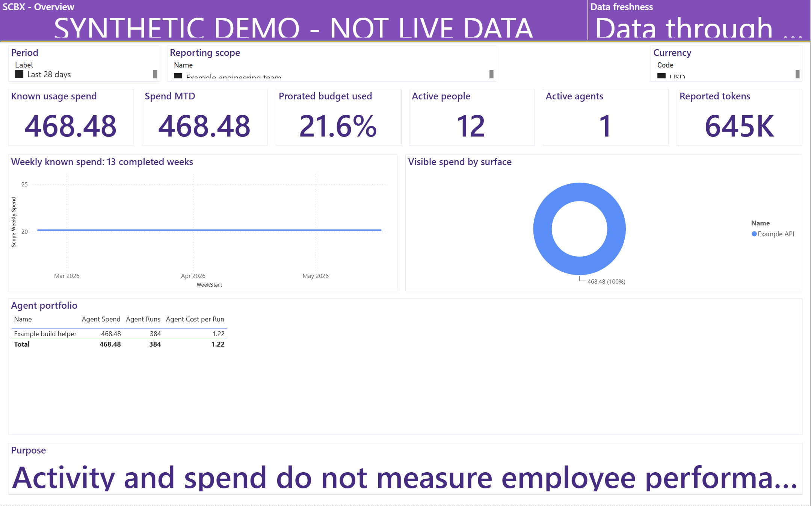
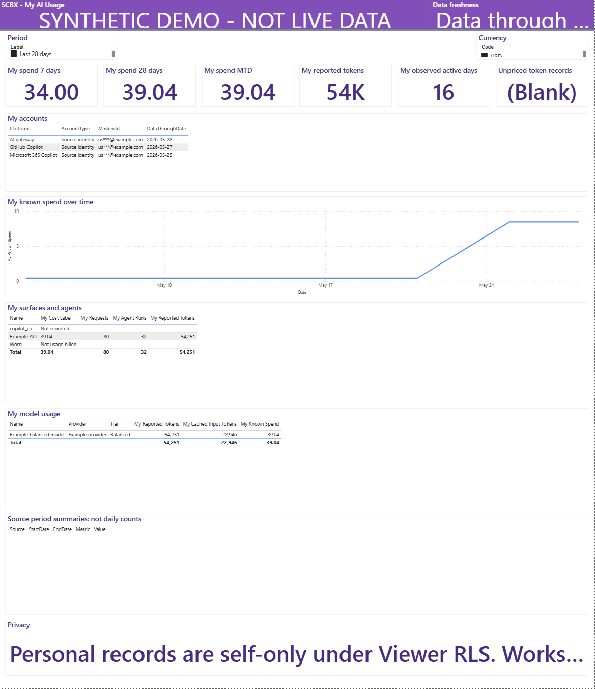
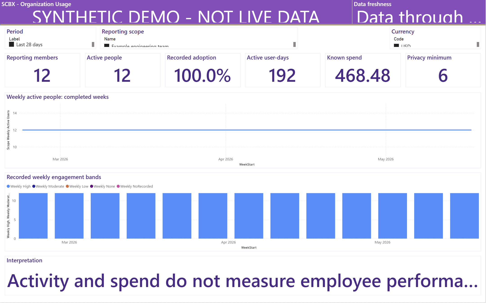
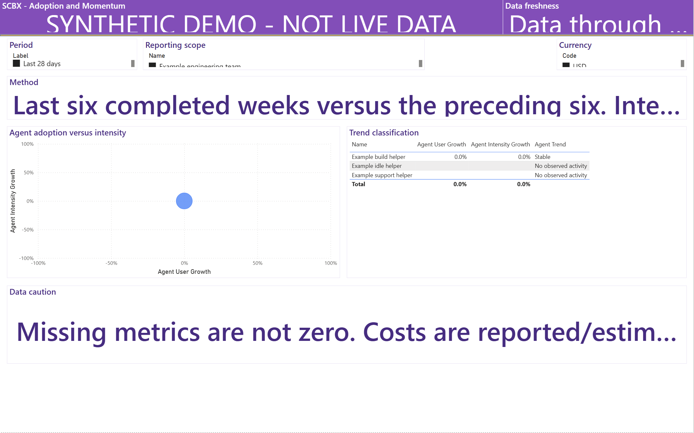
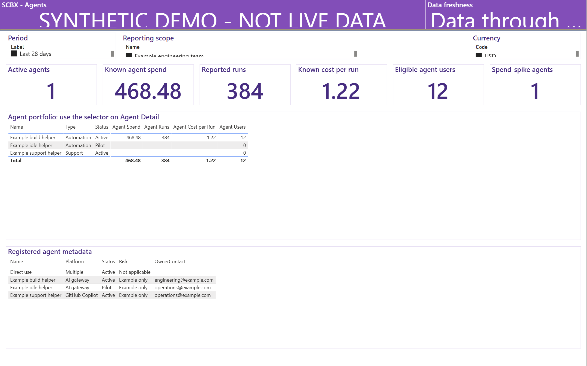
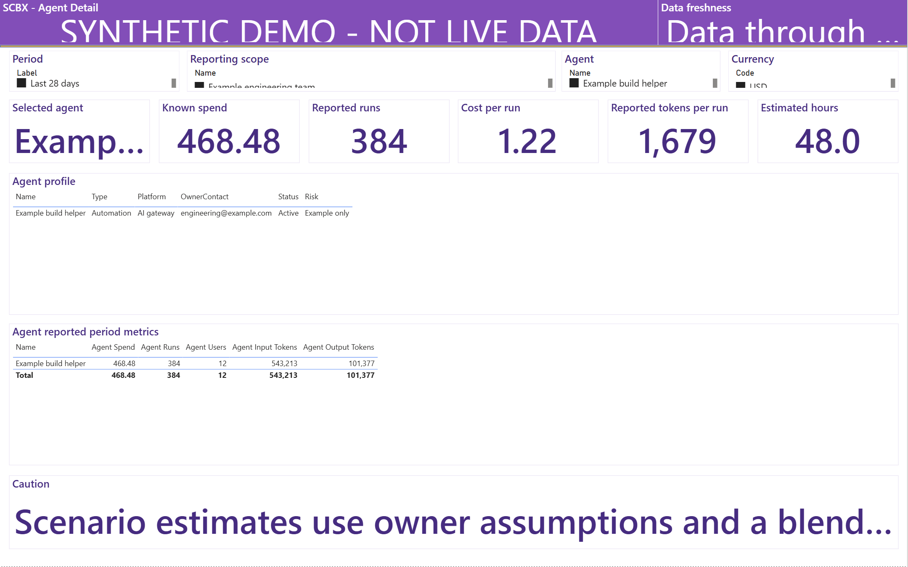
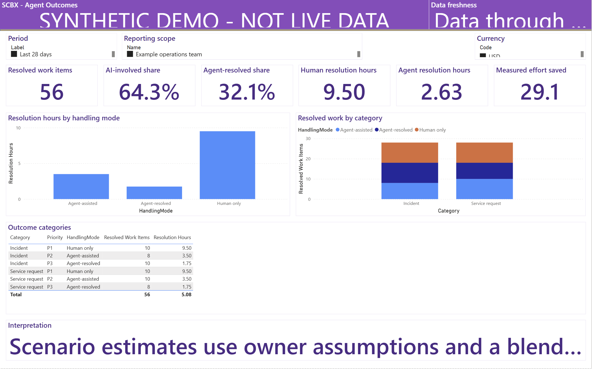
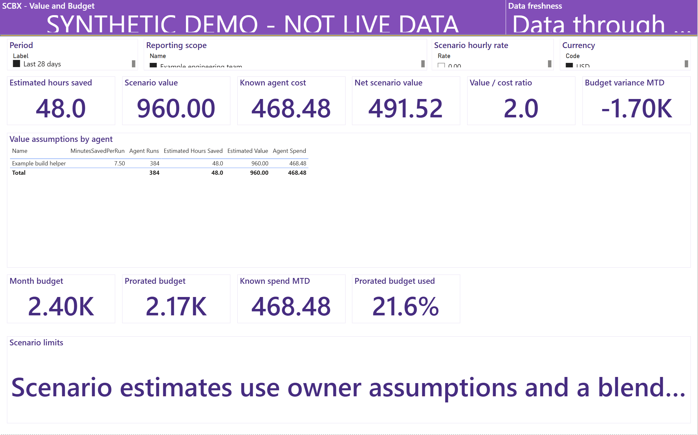
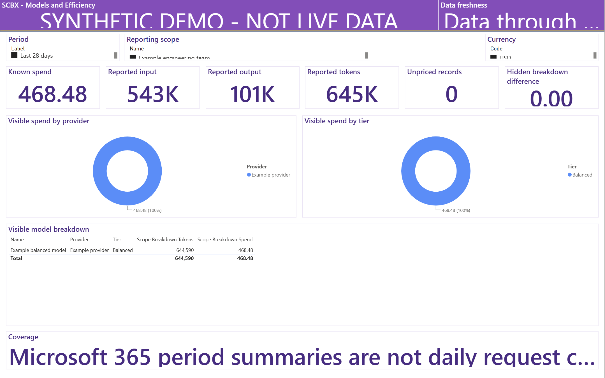
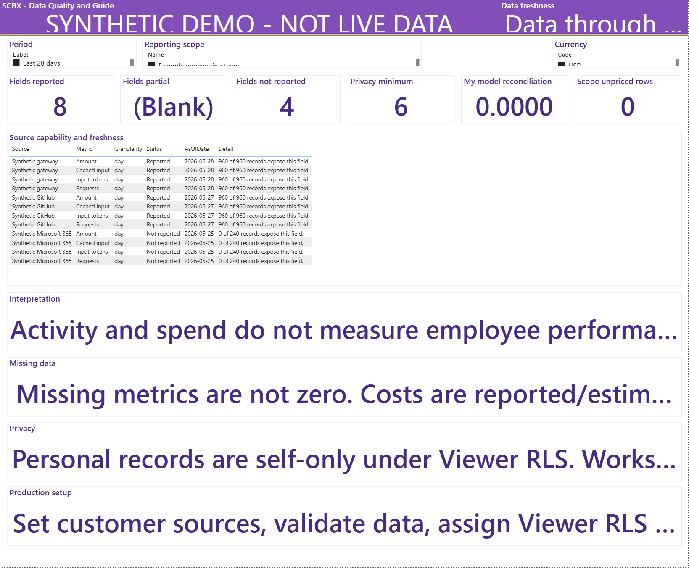

# Actual SCBX Power BI Sample Dashboard

All ten images below are **genuine Power BI Desktop report-canvas captures**
from the installed, refreshed and reopened SCBX PBIP sample. They are not HTML
mockups and were not copied from a private dashboard.

**The data is entirely fictional, not live SCBX or Microsoft tenant usage.**
Power BI Desktop **2.160.407.0** rendered every page without visual errors.
The captures omit account names, application chrome, recovery notices and
desktop paths. Only report-canvas cropping was applied; no dashboard values or
visuals were reconstructed or painted into the images.

ภาพทั้งสิบหน้าจับจาก **Power BI Desktop จริง รุ่น SCBX** ที่ติดตั้งและ Refresh แล้ว
ข้อมูลทั้งหมดเป็นข้อมูลสมมติ ไม่ใช่ยอดใช้งานของ SCBX หรือ Microsoft
ตัดส่วนบัญชีผู้ใช้และแถบโปรแกรมออก ก่อนเผยแพร่บนสาขา **scbx**

## Download or install

- Click any image to open its original PNG, or browse [all native images](images/native/).
- The [English PDF](manuals/Copilot%20Token%20Dashboard%20-%20Installation%20EN.pdf)
  and [Thai PDF](manuals/Copilot%20Token%20Dashboard%20-%20Installation%20TH.pdf)
  embed all ten native screenshots for offline use.
- Install the repaired branch PBIP using the [SCBX notes](SCBX.md),
  [English guide](INSTALLATION.md) or [คู่มือภาษาไทย](INSTALLATION_TH.md).
- The earlier `scbx-v1.0.1` compiled PBIT has not passed native loading. These
  images are evidence for the repaired local PBIP, not that old binary.

## Reproducible example settings

| Setting | Value |
|---|---|
| Source | Native PBIP with shipped synthetic sample CSVs |
| Capture date | 2026-11-01 |
| Power BI Desktop | 2.160.407.0 |
| Anchor date | 2026-05-28 |
| Period | Last 28 days |
| Reporting scope | Example engineering team, except Outcomes |
| Personal viewer | user01@example.com |
| Outcomes example scope | Example operations team |
| Scenario hourly rate | USD 20 built-in default |
| Privacy minimum | Six people |

The [native provenance manifest](images/native/provenance.json) records each
page's filters, pixel dimensions, SHA-256 and actual accessible sample values.
The separate [synthetic source manifest](assets/sample-provenance.json) records
the source CSV hashes. Neither contains private tenant information.

Fit to page preserves each report's native aspect ratio: most images are
2159 × 1349 pixels, the portrait personal page is 1169 × 1352, and the guide is
1639 × 1352. Some long cards show Power BI's normal ellipsis; the full data date
and interpretation are provided here. Empty optional tables remain empty.
Live sources, cloud publication and real recipient-user RLS were not tested.

## 1. Overview



ภาพจริงใน Power BI: ตรวจ scope และวันที่ข้อมูลก่อนอ่านยอด
ตัวอย่างทีม engineering มียอดที่ทราบ **USD 468.48**, ผู้ใช้ **12 คน** และ agent **1 ตัว**

Engineering scope: **USD 468.48 known spend**, **12 active people**,
**1 active agent** and **644,590 reported tokens**. Check scope and data date
before comparing cards. Completed-week trends do not include the latest partial
week. Unavailable usage prices are not shown as free metered consumption.

## 2. My AI Usage



หน้าส่วนตัวสมมติ: **USD 34.00** ในเจ็ดวัน และ **USD 39.04** ใน 28 วัน
ข้อมูลนี้ไม่ใช่ยอดของบัญชีที่ลงชื่อเข้าใช้บนเครื่อง

The fictional viewer has **USD 34.00 seven-day spend**, **USD 39.04
28-day spend** and **USD 39.04 month-to-date spend**. Masked account IDs and
unavailable model fields stay explicit. Production personal access must be
tested with real Viewer users in Power BI. The optional source-period-summary
table is empty in this native sample, not a fabricated daily activity feed.

## 3. Organization Usage



ภาพข้อมูลรวมของทีมสมมติ **12 คน** เกณฑ์ความเป็นส่วนตัวคือ **หกคน**
จำนวนกิจกรรมไม่ใช่คะแนนผลงานพนักงาน

The engineering example contains **12 people**. The four-person example team
does not appear as a published scope. The completed-week bands describe recorded
activity, not performance. Fixed scopes and already-suppressed data are a
different security surface from personal raw rows.

## 4. Adoption and Momentum



เปรียบเทียบหกสัปดาห์ที่จบแล้วกับหกสัปดาห์ก่อนหน้า
จำนวนผู้ใช้และความเข้มข้นของการใช้งานเป็นคนละตัววัด

Compare distinct observed users and requests per active user-week across two
six-week windows. Stable activity and a latest-week spend spike can coexist;
neither measure is an individual productivity rating.

## 5. Agents



agent ตัวอย่างมี **384 runs** ต้นทุนที่ทราบ **USD 468.48**
และต้นทุนเฉลี่ยต่อ run ประมาณ **USD 1.22**

The example build helper reports **384 runs**. The underlying synthetic spend-spike inputs are
**USD 408.00 last seven days** versus **USD 20.16 prior weekly average**.
Review context and measurement coverage; notifications require separate
approved automation.

## 6. Agent Detail



เลือก **Example build helper** เพื่ออ่านรายละเอียด
เวลาประหยัด **48 ชั่วโมง** เป็นสมมติฐานในข้อมูลสาธิต ไม่ใช่ผลประโยชน์ที่พิสูจน์แล้ว

Select the build helper to review its profile, approximate **USD 1.22 cost per
run**, reported tokens and fictional minutes-saved assumption. Missing data in
another scope is not silently replaced with numbers.

## 7. Agent Outcomes



หน้านี้เลือก **Example operations team** มีงานปิดแล้ว **56 รายการ**
ชั่วโมงตั้งแต่เปิดจนปิดกับเวลาที่คนลงมือทำเป็นคนละปริมาณ

Switch to **Example operations team**. The sample has **56 resolved work
items**: 20 human-only, 18 agent-assisted and 18 agent-resolved. Resolution time
and human effort are separate measures. No causal inference is claimed.

## 8. Value and Budget



ใช้อัตราสมมติเริ่มต้น **USD 20 ต่อชั่วโมง** เพื่อคำนวณคุณค่า **USD 960.00**
ไม่ใช่การรับประกันผลตอบแทนหรือการวัด productivity

The build-helper example uses **48 estimated saved hours** and **USD 20/hour**
to show **USD 960.00 scenario value**. The hourly-rate selector changes the assumption, not
the observed cost. Budget is prorated through May 28.

## 9. Models and Efficiency



token ตัวอย่างรวม **644,590** และยอดที่ทราบ **USD 468.48**
cached input เป็นส่วนหนึ่งของ input จึงไม่บวกซ้ำ

Cached input is a subset of input. Preserve undisclosed models, unpriced data
and any privacy-hidden breakdown difference. Synthetic token coverage is not
representative of every live vendor API.

## 10. Data Quality and Guide



ตัวอย่างมี source-field ที่รายงานได้ **8 รายการ** และไม่รายงาน **4 รายการ**
การ์ด Partial แสดง **(Blank)** เพราะไม่มีแถวที่เข้าข่าย ส่วน reconciliation คือ **0.0000**

The native table contains **8 reported** and **4 unavailable** source-field
capabilities, with no partial rows; the native Partial card renders **(Blank)**.
This display has not been repainted to show a zero. Complete validation, Desktop rendering, tenant
configuration, credentials, Viewer RLS and refresh checks before sharing.

## Browser companion: a separate illustration

The [live neutral browser companion](https://zangkasi55.github.io/Copilot-Token-Dashboard/)
and downloadable [offline HTML](assets/sample-dashboard.html) still provide
interactive conceptual examples. They are not the source of any native image
above and do not run DAX, enforce RLS or connect to a tenant.

```powershell
$env:PYTHONPATH = 'src'
python tools\build_sample_dashboard.py
npm run docs
npm run test:manuals
```

These commands rebuild the browser companion and manuals, not the native
screenshots. Reproducing the native images requires opening the repaired PBIP
in Power BI Desktop, refreshing the demo, selecting the recorded filters,
choosing Fit to page and capturing only the report canvas. Never publish account
chrome, private data or protected report exports.
