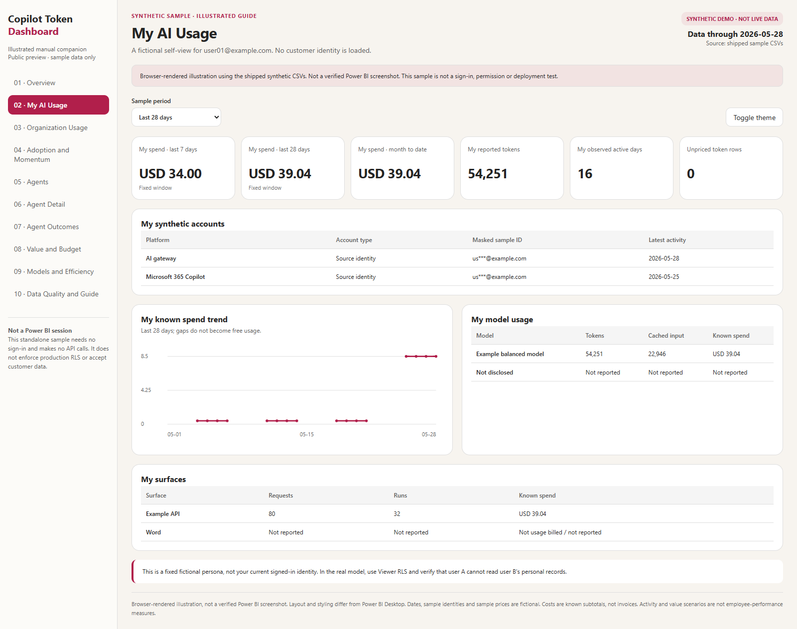

# User Guide

## Illustrated tour

The [ten-page sample gallery](SAMPLE_DASHBOARD.md) explains every page with a
full-resolution screenshot and reproducible example values. Download the
[offline dashboard companion](assets/sample-dashboard.html) to try its sample
period, scope, agent and scenario controls without sign-in.
The same synthetic companion is [available online](https://zangkasi55.github.io/Copilot-Token-Dashboard/).

These are browser illustrations using the public synthetic data, not verified
Power BI Desktop captures. They do not implement the real model's DAX or RLS.
Use the [English](INSTALLATION.md) or [Thai](INSTALLATION_TH.md) illustrated
installation manual for the actual tenant setup and acceptance checks.

## Report pages

| Page | Purpose |
|---|---|
| Overview | Eligible-scope known spend, budget, activity and agent overview |
| My AI Usage | Self-only usage, accounts, models, observed activity and source period summaries |
| Organization Usage | Fixed-scope aggregates and completed-week engagement bands |
| Adoption and Momentum | Last-six-week versus prior-six-week adoption/intensity trends |
| Agents | Portfolio, observed runs, known costs and spend-spike signals |
| Agent Detail | Selected-agent profile and reported period metrics |
| Agent Outcomes | Resolution-date handling modes, elapsed hours and effort comparison |
| Value and Budget | Explicit scenario assumptions, hourly rate, estimated value and budget |
| Models and Efficiency | Visible model/provider/tier breakdowns with coverage limits |
| Data Quality and Guide | Source fields, freshness, unpriced data and interpretation |

Select the period, approved reporting scope and currency before interpreting
organization figures. Personal figures remain tied to the signed-in viewer,
not another selected employee.

## Definitions

- Reported tokens: source input plus output tokens; missing fields stay missing.
- Cached input: a subset of input, not an additional quantity to count twice.
- Cache ratio: shown only with adequate cache-field coverage.
- Known spend: reported billed amounts or explicitly priced estimates, not a
  guarantee of invoice reconciliation.
- Observed active day: a day with actual recorded activity; a last-activity feed
  may provide only a lower bound.
- User-day: one person on one calendar day. Multiple surfaces can overlap.
- Completed week: Sunday through Saturday; the latest incomplete week is not
  treated as complete.
- High engagement: at least four recorded days; moderate two or three; low one.
- None versus no recorded usage: no activity in the window versus no recorded
  history in the available data. Neither proves the absence of actual AI use.
- Scope suppression: insufficient privacy cohort or observed active group; not
  a numeric zero and not an error to bypass.
- Agent run: only a reported invocation/run count. A used-agent Boolean is not
  automatically converted into one run.

## Value and outcomes

Scenario value uses an owner-reviewed minutes-saved assumption and a blended
hourly rate. Measured effort comparisons depend on comparable categories and
available time tracking. Neither proves causal productivity improvement.

Use these insights for cost awareness and responsible operations, never to rank
or evaluate individual employees.
